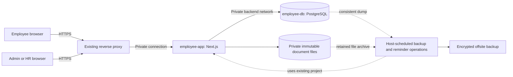
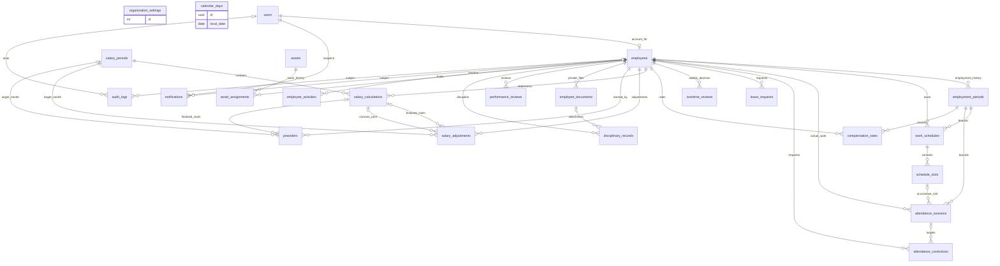

# GriipBuddy Employee & Workforce Management

**Final reviewed architecture — V2.0**  
**Freeze date:** 9 October 2026  
**Status:** FROZEN architectural specification, as requested  
**Deliverable:** Architecture review, final design and change record only

This document replaces the architecture produced on 8 October 2026. The original product requirements and the subsequent review request govern this revision. The **ARCHITECTURE FREEZE** section contains the final selected design; **ARCHITECTURE CHANGES FROM V1** immediately follows it.

Freezing this specification does not start product development. No application, UI, production code, database migration, deployment or VPS change is included. Business defaults below are explicit product decisions; architecture review does not certify compliance with employment, tax or retention law.

**Navigation:** [Review findings](#1-architecture-review-outcome) · [Table review](#4-final-database-model-and-table-review) · [Relationships](#5-final-database-relationships) · [Access rules](#6-final-permission-model-and-employee-isolation) · [Salary](#11-final-salary-and-compensation-model) · [Business rules](#20-final-business-rule-table) · [Freeze](#architecture-freeze) · [Changes](#architecture-changes-from-v1).

## 1. Architecture review outcome

The selected architecture remains **one Next.js application, one PostgreSQL database and one independent Docker Compose project**. Two persistent containers are sufficient. Private document files use a dedicated volume. An existing host scheduler performs backups and invokes small reminder tasks through the same app image; there is no worker service, queue, Redis or separate backend.

The table count remains **24** after reviewing every entity. Combining accounts with employment profiles would weaken lifecycle/ownership clarity; combining requests with actual attendance would mix proposed and approved facts; combining assets with their assignments would lose return/reissue history. The useful simplification is in workflows and stored state, rather than discarding necessary records to achieve an arbitrary table count.

### 1.1 Findings and dispositions

Priorities indicate consequences if the original ambiguity survived implementation; they do not imply a deployed vulnerability exists.

| Priority | Finding in the initial design | Final disposition and reason |
|---|---|---|
| High | Check-in only before the slot ended imposed an extra restriction beyond the early-arrival requirement. | Allow same-day late check-in after scheduled end; preserve actual time and identify the missed scheduled work. Historical missed dates use correction. |
| Medium | One non-voided session per occurrence prevented a legitimate checkout followed by return within the same work period. | Allow multiple non-overlapping sessions per occurrence; keep exactly one open session per employee and operation-key retry protection. |
| High | “Server time inside the transaction” did not distinguish current wall time from a transaction's earlier start time. | Read database `clock_timestamp()` after obtaining locks and truncate to whole seconds. Never round up across the early boundary. |
| Medium | Special/temporary schedules were not explicit, and blanket exclusion of day-specific changes was too broad. | Represent temporary and one-day patterns with the existing bounded schedule versions and an explicit restoring version. No extra override table. |
| Medium | Overtime stored candidate and approved interval arrays, source fingerprints and arbitrary selected portions. | Store one reviewed approved duration. Derive candidates and allocation deterministically from chronological actual sessions; retain the derived detail in salary snapshots. |
| High | Fingerprints and a complex multi-period lock order left source insertion and period creation races underspecified. | Use one short PostgreSQL payroll-mutation transaction lock, affected-period input revisions and ordinary employee/asset locks. All relevant source changes and pay transitions follow the same protocol. |
| Medium | Custom salary periods and employee exclusions were optional additions, not required product functionality. | Pay everyone through calendar-month periods; include every overlapping employee, even with zero pay or departed status. Remove exclusion fields/workflows. |
| High | Audit append-only access could be ineffective if the runtime credential owned the database objects. | Migration-owned objects; non-owner runtime role with INSERT/authorized SELECT on audit only, no UPDATE/DELETE/TRUNCATE or DDL capability. |
| High | Finalized pay immutability was stated without an explicit database enforcement boundary. | Database guards reject modification/deletion of finalized periods/statements and reassignment of finalized inclusion claims. Later corrections use reviewed adjustments. |
| High | Historical permission evidence and commission-derived adjustment/attachment paths required stronger retention and output rules. | Preserve eligibility evidence; classify commission corrections; deny every indirect disclosure path and apply parent publication checks to attachments. |
| Medium | Nightly global write maintenance paused attendance and password counters unnecessarily. | Database dump followed by an immutable-file archive while only physical deletion/garbage collection is suspended. Files are durable before metadata commits. |
| Medium | No default existed for historical retention or deferred pay issues. | V1 performs no automatic business-history purge. Pay-affecting requests are resolved before finalization; pending commissions may be explicitly deferred. |
| Medium | A proposed host port and two proxy adapters could be mistaken for verified deployment facts or competing frozen architectures. | Freeze a single ingress contract: existing HTTPS proxy is the sole public ingress, with a private app connection. Actual proxy attachment/port is recorded after later read-only inventory. |

### 1.2 What was verified in this review

The review checked requirement coverage, relationships, ownership paths, boundary rules, formulas, history preservation, authorization surfaces and concurrency/backup protocols. The final design below resolves the identified issues without adding a service or removing a required product area.

There is no running implementation or inspected VPS in this phase. Runtime authorization, PostgreSQL privileges, network exposure, dependency compatibility and restore performance remain mandatory future acceptance checks. This document does not report those checks as already passed.

## 2. Final system architecture and dependencies

The scheduler and one-off operations are not persistent application services. There are five product modules, all in the same application:

| Module | Included functionality |
|---|---|
| People | Accounts/profiles, employment history, documents, work records/timeline, performance, discipline and assets. |
| Time & leave | Employee schedules, holidays, attendance, correction requests, leave and weekly overtime review. |
| Pay | Compensation history, salary periods, calculations, adjustments and optional pre-order commissions. |
| My portal | Personal views, check-in/out and permitted employee requests/submissions. |
| System | Organization settings, role/feature grants, audit, notifications and operational status. |

### 2.1 Stack and necessity review

| Component | Decision | Why it is necessary or excluded |
|---|---|---|
| Next.js App Router + TypeScript | Keep, Node runtime | One application provides pages, authentication, server calculations and mutations. No separate Express service. |
| Tailwind CSS + shadcn/ui | Keep for later UI development | Requested stack and ordinary reusable components; no UI is built here. |
| PostgreSQL + Prisma | Keep | Relational ownership, effective dates, transactions, constraints and typed database access. |
| Auth.js Credentials, encrypted JWT-cookie sessions | Keep | Existing preferred authentication approach; application users/hashes remain in PostgreSQL, avoiding unused adapter tables. |
| Decimal arithmetic | Use Prisma's decimal support | Required for predictable money calculations; no second financial-math package. |
| Timezone-aware date library | One library compatible with the chosen Node runtime | Needed for IANA-zone occurrence resolution and local-date boundaries. No second scheduling/date framework. |
| Server-side validation | One typed validation library | Shared input schemas and safe field allowlists; no generated generic CRUD framework. |
| Argon2id implementation | Keep one maintained implementation | Secure password hashes; no custom cryptography. |
| Image validation/decoding | One maintained library where necessary | Staff-uploaded JPEG/PNG validation and resource limits; no image-processing service. |
| Server-only access/domain functions | Keep as normal folders/functions | Authorization close to each query and server calculations. No generic repository, policy engine or plugin system. |
| Docker Compose | Keep | Independent two-container deployment with persistent storage. |
| APIs | Auth, protected file transfer and minimal health routes only | Forms use Server Actions; Server Components call internal server functions directly. No parallel REST CRUD API, GraphQL or external-client API. |
| Redis, message broker, workers, microservices, Kubernetes | Exclude | PostgreSQL transactions, a single instance and small host-scheduled operations suffice. |

Patch/package versions are pinned as a compatible, security-maintained set when later development is authorized; version numbers are release inventory, not alternative architecture. An authentication compatibility check must confirm the selected supported Auth.js/Next.js versions before implementation proceeds. Substitution that changes persistence/session architecture requires a revision.

Next.js recommends server-only authorized data access returning minimal response objects, and treats Server Actions as remotely callable mutation entry points. [Next.js data security](https://nextjs.org/docs/app/guides/data-security)

## 3. Frozen operating defaults

| Setting or policy | Final V1 decision |
|---|---|
| Organization | One company; no multi-company or department-scoped access engine. |
| Official timezone/currency | `Asia/Dhaka`, `BDT`, two currency decimals. These are explicit assumptions selected for this specification. |
| Workweek | Monday 00:00 inclusive to next Monday 00:00 exclusive, in company time. |
| Early check-in allowance | 10 minutes initially; admin can configure 0–60 minutes. |
| Weekly overtime threshold | 40 actual hours initially; future-week effective changes allowed. No automatic payable overtime. |
| Salary period | One calendar month for all employees, irrespective of compensation type. |
| Monthly base | Calendar-day proration for employment/rate changes; no automatic lateness/absence/unpaid-leave deduction. |
| Hourly base | Ordinary actual time plus eligible paid absence, excluding approved overtime seconds that are paid separately. |
| Daily base | Proportional regular coverage of that date's original schedule, maximum one day unit. |
| Paid absence | Original scheduled paid leave/holiday time not actually worked; union overlapping credits. Unpaid leave takes precedence over holiday credit. |
| Breaks | No automatic break deduction; time outside recorded sessions is not actual work. |
| Off-schedule work | HR records approved factual work through the correction flow; a temporary schedule can be published in advance. |
| Overtime rate | Agreed hourly equivalent and multiplier; default multiplier 1.0. Monthly/daily hourly equivalent must be entered explicitly. |
| Employee commission feature | Disabled by default; one flag enables both own pre-order access and earning eligibility. |
| Salary approval/finalization | Admin only; HR prepares/calculates/reviews within its commission authority. |
| HR access | Company-wide People/Time/ordinary Pay access; commission management requires one explicit grant. |
| Documents | Staff uploads; employee reads only its own permitted released files. PDF/JPEG/PNG, maximum 10 MiB. |
| Login/session | No public registration; 24-hour temporary password, forced change; fixed 12-hour absolute session maximum. |
| Retention | No automatic deletion of employment, attendance, pay, permission evidence, audit or private-document history in V1. Admin-controlled retention is separately recorded. |
| Backups | Nightly and pre-change; encrypted offsite copy; 7 daily, 4 weekly, 6 monthly sets. RPO ≤24h and RTO ≤4h are targets to demonstrate. |
| Availability | One app instance and one database on existing VPS; short release maintenance acceptable. No HA promise. |

Changing timezone, currency or week start after official records exist requires a reviewed historical-transition revision. Ordinary future threshold/commission settings changes use the specific rules below. The business policies above are transparent product defaults, not an implied statutory calculation engine.

## 4. Final database model and table review

### 4.1 Entity-by-entity necessity review

All 24 tables are retained. This table records why each exists, why it is not safely merged, and the ownership/history boundary. Detailed fields and constraints follow.

| # | Table | Why it exists / merge decision | Ownership and history |
|---|---|---|---|
| 1 | `organization_settings` | One singleton for organization policy; no separate policy/commission-settings table. | Company scope; audited policy edits, small typed threshold history. |
| 2 | `calendar_days` | Searchable holiday dates used across employee schedules/pay; do not bury an unbounded calendar in settings JSON. | Company scope, dated revisions and audit. |
| 3 | `users` | Credentials, access status and role; separate from employee data because an admin account need not be an employee. | Account identity and actor attribution retained after disablement. |
| 4 | `employees` | Persistent employee identity/profile/eligibility; no credential duplication or repeated person on rehire. | One required unique user link, one stable employee ID. |
| 5 | `employment_periods` | Separate join/leave/rehire stints; two dates on the employee cannot preserve multiple stints. | Employee-owned, non-overlapping intervals; department/position labels and audited changes. |
| 6 | `work_schedules` | An employee's dated weekly pattern; also serves as its assignment and temporary replacement. | Employee/stint-owned; preserve superseded patterns. |
| 7 | `schedule_slots` | Arbitrarily many weekday intervals are a child collection, not fixed first/second/third columns. | Ownership inherited through schedule; published slots retained. |
| 8 | `attendance_sessions` | Actual time facts for multiple work periods and returns; no daily aggregate table. | Employee/stint-owned; original revisions in audit/correction history. |
| 9 | `attendance_corrections` | Proposed and reviewed changes must remain distinct from actual attendance. | Employee-owned request and target/applied-session links. |
| 10 | `leave_requests` | Paid/unpaid absence and a simple decision are not attendance sessions. | Employee/stint-owned intervals and decision history. |
| 11 | `overtime_reviews` | A weekly approval cannot be represented by an unreviewed daily extra-time total. | Employee/week-owned quantity, input revision and decision; no interval subtable. |
| 12 | `compensation_rates` | Effective-dated compensation is both current compensation and salary history. | Employee/stint-owned; superseded rows preserved. |
| 13 | `salary_periods` | Common month and lifecycle; no duplicated month state on every source record. | Company scope; finalized period immutable. |
| 14 | `salary_calculations` | One employee-month statement and durable calculation inputs; cannot be a live query over changing facts. | Employee-owned immutable final snapshot; same employee/month unique. |
| 15 | `salary_adjustments` | Multiple approved bonuses/deductions/corrections have independent reasons and decisions. | Employee/month-owned; unique finalized claim and prior-statement correction link. |
| 16 | `preorders` | Combines order, commission, approval and pay inclusion; no separate commission ledger/rule table. | Employee/stint-owned, rule/eligibility snapshot and finalized claim. |
| 17 | `employee_documents` | Private metadata/permissions/expiry are separate from actual bytes. | Employee-owned immutable storage keys; optional stint, soft deletion. |
| 18 | `performance_reviews` | Structured ratings and publication cannot be safely mixed with free-text work notes. | Employee/stint-owned, published record and edit audit. |
| 19 | `disciplinary_records` | Severity, action and acknowledgement need typed fields, unlike performance/work notes. | Employee/stint-owned; publication, revocation and acknowledgement preserved. |
| 20 | `assets` | Inventory identity exists when no employee holds the asset. | Company scope; inventory cannot be replaced by assignment-only rows. |
| 21 | `asset_assignments` | Asset return/reissue history is many-to-one, unlike a current holder column. | Employee/stint-owned assignment, linked asset and issue/return facts. |
| 22 | `employee_activities` | Unified published chronology and manually entered work records; no duplicated domain payloads. | Employee-owned, publication/commission filtering; source remains authoritative. |
| 23 | `notifications` | Recipient read/unread and deduplicated alerts are different from timeline/history. | Recipient-user-owned; detail links reauthorized. |
| 24 | `audit_logs` | Restricted actor/before/after history must not be the employee-visible timeline. | Optional affected employee plus actor; database-enforced append-only runtime access. |

No master departments/positions/document-types table is needed: use controlled labels or small enums. No schedule-assignment/template table, materialized occurrence table, daily attendance summary, compensation-profile/history pair, separate commission table, generic permissions/workflows or authentication-adapter table is introduced.

### 4.2 Shared schema conventions

This is a **logical specification**, not SQL, a Prisma schema or a migration.

- IDs are UUIDs except singleton settings ID 1. All ordinary rows have creation timestamps; mutable rows have update timestamps. Relevant edited domain records have integer `revision` values. Actor/reviewer IDs reference retained `users` rows.
- Instants use `timestamptz` and serialize in UTC. Business dates use `date`; schedule clocks are integer minutes. Attendance instants are truncated consistently to whole seconds.
- Date/time ranges are half-open: `[start, end)`. October 1–31 is stored as October 1 inclusive / November 1 exclusive. An employment end is the first non-employed date.
- Money is `numeric(18,2)`, percent/multiplier is `numeric(9,4)`. Server calculation uses Prisma Decimal, integer seconds and a recorded half-up rounding rule.
- Every employee-domain record has required `employee_id`, except slots, which inherit it through their schedule. Stint-specific rows also have `employment_period_id`. Weekly reviews and salary statements can span stints and list their constituent stints in the snapshot.
- `?` below means nullable. Required subject/ownership fields cannot be reassigned to another employee. Foreign keys restrict deletion of referenced historical rows.
- JSON is limited to bounded contacts, dedicated policy history, safe audit facts and immutable calculation snapshots. Shape/size is validated. Relationships and commonly queried facts remain typed columns/FKs.
- Safe output objects are separate from ORM records. Raw hashes, secrets, bank details, source snapshots and nested employee/user objects never automatically enter a client response.

### 4.3 Final fields and constraints

| Table | Important fields beyond common ID/timestamps | Required constraints and indexes |
|---|---|---|
| `organization_settings` | `company_name`, `timezone`, `currency`, `early_checkin_minutes`, `overtime_policy_versions` JSON, `commission_rule_type`, `commission_rule_value`, `rules_version`, `changed_by`, `last_successful_backup_at?` | Exactly ID 1; valid IANA zone/currency; early range 0–60; policy versions have unique ascending Monday start dates and positive threshold seconds; fixed commission ≥0, percentage 0–100. No duplicate current-threshold column. Operational backup timestamp is not payroll policy. |
| `calendar_days` | `local_date`, `name`, `created_by`, `revision` | Unique local date; full-day company holiday. Changes affecting calculations invalidate affected unfinished periods. Index date. |
| `users` | normalized `email`, staff-only `display_name?`, `password_hash`, `role`, `is_active`, `can_manage_commissions`, `session_version`, `must_change_password`, `temporary_password_expires_at?`, failure count/last-failure/lock-until, `password_changed_at?` | Unique normalized email; role enum ADMIN/HR_MANAGER/EMPLOYEE; non-owner runtime cannot grant database privileges. Last active admin cannot be demoted/disabled. HR commission flag false unless role HR_MANAGER. Employee display name derives from profile; staff-only accounts use their safe label. |
| `employees` | `user_id`, unique `employee_number`, `legal_name`, `preferred_name?`, `phone?`, `address?`, emergency contact JSON, restricted bank-details JSON, `preorder_commission_enabled`, `created_by` | Required unique user link; employee number unique; eligibility false by default. Profile editable-field allowlist; no stored derived current schedule/rate/status and no extra profile-only revision counter. |
| `employment_periods` | `employee_id`, `start_date`, `end_date?`, department/position labels, `end_reason?`, `created_by`, `revision` | Unique `(id, employee_id)`; positive non-overlapping ranges per employee; at most one open stint. Index employee/start. |
| `work_schedules` | `employee_id`, `employment_period_id`, `effective_from`, `effective_until?`, `label?`, `holiday_work_required` default false, `superseded_at?`, `created_by`, `change_reason`, `revision` | Composite stint/employee FK; non-superseded ranges do not overlap. Publish validates coverage and neighboring overnight slots. Holiday-work flag requires a bounded staff-approved temporary pattern/reason. Empty pattern explicitly represents a temporary rest period. Index employee/effective dates. |
| `schedule_slots` | `work_schedule_id`, `weekday` 1–7, `start_minute` 0–1439, `end_minute` 0–1439, `end_day_offset` 0/1 | Positive duration ≤24 wall-clock hours; no cyclic-week or version-boundary overlap; FK restricts deletion. Index schedule/weekday. No fixed slot-count limit. |
| `attendance_sessions` | `employee_id`, `employment_period_id`, `schedule_slot_id?`, `work_date`, resolved scheduled start/end snapshot?, timezone/rule/early-window snapshots, `checkin_at`, `checkout_at?`, `source` SELF/CORRECTION, `voided_at?`, `void_reason?`, `created_by`, `revision`, check-in/out operation keys? | Composite stint/employee FK; slot ownership checked through schedule. Unique `(id, employee_id)`. Partial unique employee where open and non-voided; exclusion constraint rejects overlapping non-voided actual ranges, treating open end as unbounded. Completed checkout > check-in; scoped operation keys unique. No occurrence uniqueness constraint. Index employee/work date and check-in. |
| `attendance_corrections` | `employee_id`, `employment_period_id`, target `session_id?`, ADD/REPLACE/VOID, proposed work date/slot/timestamps?, reason, original values, target revision?, status, requester/reviewer/time/note, `applied_session_id?` | Same-employee target/applied-session FKs; ADD has no target, REPLACE/VOID require target. Approval revalidates times/stint/ownership/overlap/current revision. Index employee/status and pending creation time. |
| `leave_requests` | `employee_id`, `employment_period_id`, `start_at`, `end_at`, PAID/UNPAID, reason, status, requester/reviewer/time/note, `revision` | Positive interval within stint; approved intervals cannot overlap per employee; PENDING/APPROVED/REJECTED/WITHDRAWN/CANCELLED. Index employee/start/status. |
| `overtime_reviews` | `employee_id`, `week_start_date`, timezone/threshold/version snapshot, `actual_seconds_snapshot?`, `potential_seconds_snapshot?`, `approved_seconds`, status, reviewer/time/reason, `revision` | Unique employee/week; Monday alignment. PENDING/APPROVED/REJECTED/NOT_REQUIRED/STALE. Approved duration 0–current potential; snapshots current only after recomputation/decision. No stored candidate/approved arrays or source hash. Index status/week. |
| `compensation_rates` | `employee_id`, `employment_period_id`, effective dates, `superseded_at?`, MONTHLY/HOURLY/DAILY, `base_amount`, `currency`, `overtime_hourly_equivalent?`, `overtime_multiplier`, change reason/creator, `revision` | Composite ownership FK; positive non-overlapping non-superseded ranges within stint. Ordinary amount/equivalent ≥0, multiplier ≥1. Currency matches company. Hourly equivalent derives from hourly amount for HOURLY, not a duplicated stored value. Index employee/effective dates. |
| `salary_periods` | `start_date`, `end_date`, timezone/currency snapshot, status, `input_revision`, `calculated_input_revision?`, calculation/review/approval/finalization actors and timestamps | One exact calendar month; unique start date. DRAFT/CALCULATED/REVIEWED/APPROVED/FINALIZED. Input revision advances on relevant source changes; no source fingerprint or redundant editable month label. Finalized row guarded against UPDATE/DELETE. |
| `salary_calculations` | `employee_id`, `salary_period_id`, `input_revision`, base/OT/commission/bonus/deduction/signed-other/final amounts, `calculation_snapshot` JSON with format version/source facts/segment detail, `calculated_by`, `calculated_at`, `finalized_at?` | Unique employee/period; unique `(id, employee_id)` and `(id, employee_id, salary_period_id)` for correction/claim FKs. Final equals rounded components, never negative at approval. Finalized row immutable. No roster-exclusion flags, duplicate input/breakdown blobs or duplicate aggregate columns already in the snapshot. |
| `salary_adjustments` | `employee_id`, target `salary_period_id`, `included_salary_calculation_id?`, BONUS/DEDUCTION/OTHER/CORRECTION, amount/reason/status, `commission_related`, restricted source reference?, creator/approver/time, `corrects_salary_calculation_id?`, reconciliation snapshot?, operation key, `revision` | Type/sign rules; same-employee prior-statement FK for corrections; nullable composite claim FK to target statement. Claim cannot change after finalization. Unique operation key; at most one unsettled non-rejected reconciliation correction per original statement. Index employee/period/status. Commission marker server-controlled. |
| `preorders` | `employee_id`, `employment_period_id`, `order_at`, normalized reference, `order_value?`, currency, commission type/value/version snapshot, eligibility snapshot/evidence reference, computed amount/status, target `salary_period_id?`, `included_salary_calculation_id?`, creator/approver/time/inclusion/reason, `revision` | Company-wide unique reference including cancelled records; composite stint FK; future order claims rejected; historical eligibility evidence verified. Percentage requires nonnegative value. INCLUDED needs a same-employee/period statement claim. Claim/approved included facts immutable. Local order date derives from timestamp, no duplicate stored date. Index employee/order time and status/period. |
| `employee_documents` | `employee_id`, optional stint, type, safe display name, generated storage key, detected MIME, size, SHA-256, `expires_on?`, `employee_visible`, uploader, `deleted_at?`, deletion reason | Unique key and `(id, employee_id)`; optional composite stint FK; MIME/size allowed; owner/key immutable. Index employee/type/expiry. Parent warning access also applies. No file bytes or public URL in database. |
| `performance_reviews` | `employee_id`, stint, review dates/reviewer, nullable draft overall rating and five dimension ratings, strengths/improvement/comments, `staff_notes?`, `published_at?`, `revision` | Composite ownership FK; positive review period; ratings 1–5; overall rating required at publication; no self-publication by HR. Index employee/review dates/publication. |
| `disciplinary_records` | `employee_id`, stint, issue date, reason/description, severity/action, issuer, `attachment_document_id?`, published/acknowledged times and actor?, revoked time/reason?, `revision` | Composite stint and same-employee attachment FKs; NOTICE/WARNING/SERIOUS_WARNING/FINAL_WARNING; only subject account acknowledges after publication. Index employee/issue date. |
| `assets` | unique `asset_code`, type, serial?, inventory condition, `status` AVAILABLE/RETIRED/LOST, notes/creator | Asset code unique; serial not assumed globally unique across all types. Current assigned state/holder derives from open assignment, so no duplicated ASSIGNED status. |
| `asset_assignments` | `asset_id`, `employee_id`, stint, assigned/returned timestamps, conditions out/in, notes, issue/return actors | At most one unreturned assignment per asset; return ≥ issue; composite ownership FK; retired/lost assets cannot be newly issued. Index employee and asset/issue date. |
| `employee_activities` | `employee_id`, event time/type, safe title/description, source type/ID?, event key?, employee-visible flag, commission restriction marker, creator? | Unique non-null event key; index employee/time. Derived events reauthorize source on read. Manual notes require explicit release; preserve edited content in audit. No copied full pay/review/file payload. |
| `notifications` | `recipient_user_id`, optional employee, event type/safe text/source, unique event key, read timestamp? | Unique recipient/event key; index recipient/unread/time. Access requirement derives from specific event type, not a second flag that can contradict type. Links reauthorized. |
| `audit_logs` | actor?, affected employee?, action/entity/ID, server event time, reason, minimized before/after JSON, request ID, system source? | Runtime INSERT/authorized SELECT only; no UPDATE/DELETE/TRUNCATE/DDL. Index employee/time, entity/ID/time, actor/time. Historical grant evidence retained. |

### 4.4 Database safeguards and simpler concurrency

Use PostgreSQL uniqueness/check/exclusion constraints for one open session, no overlapping actual/leave/effective intervals, month uniqueness, and one open asset assignment. Cross-row rules such as weekly-slot overlap and parent publication are validated in locked domain operations. PostgreSQL's range exclusion constraints support non-overlap protection. [PostgreSQL range constraints](https://www.postgresql.org/docs/current/rangetypes.html#RANGETYPES-CONSTRAINT)

All writes affecting payroll inputs and all pay calculation/review/finalization transitions acquire **one named PostgreSQL transaction advisory lock** before accessing the affected rows. This includes schedule/employment/rate changes, attendance mutations/corrections, leave/holiday decisions, weekly overtime decisions, commission/adjustment changes and monthly-period creation. Account role/feature-grant changes follow the same lock before their user-row locks so authorization checks cannot deadlock with protected pay operations. The lock serializes short critical write sections for this small company and eliminates a distributed-lock or elaborate period-lock hierarchy. Do not hold it during file transfer, hashing, backup, report rendering or a user's review. Relevant user rows, then employee rows, then domain rows are locked in stable ID order; unrelated asset-only changes need just the asset lock. Use bounded waits/retries and actionable busy feedback. PostgreSQL provides transaction-scoped advisory locking. [PostgreSQL locking](https://www.postgresql.org/docs/current/explicit-locking.html#ADVISORY-LOCKS)

Under that lock, calculate which unfinished months depend on a change. Attendance dependencies include **the complete weeks intersecting the month**, not just its dates; a next-month session can affect the prior month's boundary-week overtime. Other sources use their affected dates, conservatively widened to those boundary weeks where needed. Advance each affected period's `input_revision`, return it to DRAFT and clear review/approval. Unrelated later work does not invalidate an already closed month's dependencies. Attendance changes also advance/mark stale affected weekly reviews.

If changed historical sources affect a finalized statement with an outstanding reconciliation correction, also invalidate that correction's target month and reset its approval pending recomputation. This dependency applies even when the target month does not overlap the historical source date. Reconciliation approval rechecks current source facts and already finalized deltas under the same lock; a source update cannot leave a stale correction ready to pay.

Calculation rows record the period's input revision. Review/approval/finalization require that revision to match, current weekly decisions, complete roster and no unresolved blocker. A newly created employee/stint or source inserted after calculation is covered by the same lock/revision protocol; checking only previously enumerated row IDs is insufficient. Generate calculation data server-side and commit it at the verified revision. No generic content hashing/fingerprint framework is required.

To keep the critical section short, capture the period input revision and a consistent set of authorized source facts under the lock, release it for in-process arithmetic, then reacquire it to recheck the revision, current grants, roster and blockers before committing outputs. A mismatch discards the computed result and retries or requests recalculation. The initial revision is captured before reading sources, never only after computing them. No intermediate client-supplied calculation or background queue is involved.

A migration-owned database guard rejects UPDATE/DELETE of finalized periods/statements and of included pre-order/adjustment source rows, including clearing or reassigning their claims. The application runtime role cannot disable these guards. Required audit inserts are in the same transaction as a mutation; failure rolls the mutation back. Unsupported ORM constraints/guards can be expressed in small reviewed database-specific migration additions during future development. None is created now. [Prisma migration guidance](https://docs.prisma.io/docs/orm/prisma-migrate/workflows/unsupported-database-features)

## 5. Final database relationships

Every employee has exactly one linked account; a staff-only account may have none. The diagram omits repeated creator/reviewer/stint relations for clarity; §4 defines them. Singleton settings and holidays are company data without artificial tenancy keys. Lightweight type/ID references in timeline/audit/notifications are metadata, never a foreign-employee fetch authorization.

Draft pre-orders/adjustments can target a salary period before its employee calculation exists. At finalization, `included_salary_calculation_id` and the composite employee/period FK establish their immutable claim. The original statement referenced by a CORRECTION adjustment is a separate same-employee relationship. This distinguishes intended month, actual inclusion and historical correction.

## 6. Final permission model and employee isolation

### 6.1 Exactly three roles and two narrow flags

- `ADMIN`: all company management, grants/settings and final pay approval.
- `HR_MANAGER`: company-wide employee/time/ordinary compensation management; no account-role/feature grants.
- `EMPLOYEE`: personal portal only.

`employees.preorder_commission_enabled` controls both own pre-order access and earning eligibility. It is false by default. The names `can_use_preorder` and `can_earn_preorder_commission` are conceptual aliases, not separately mutable flags.

`users.can_manage_commissions` grants commission management to HR only, false by default. Admin has this authority inherently. Eligibility for a manager's own employee portal remains separate from its staff management grant.

Publication fields release an employee's own document/review/note/warning. They are record visibility, not an enterprise permission engine. Admin alone edits roles, feature grants, commission settings and organization policies. All grants are audited. Preserve the last active admin. HR cannot approve its own correction, leave, overtime or salary adjustment or publish its own review/warning; admin handles those cases. Admin self-approval is permitted with a recorded actor trail for a small company.

### 6.2 Simple permission matrix

“HR+C” is an HR manager with the explicit commission grant. Personal area access always follows own-record rules, even for staff.

| Resource/action | ADMIN | HR_MANAGER | EMPLOYEE |
|---|---|---|---|
| Accounts/roles/feature grants/policy settings | Manage | No general account/grant management | Own password only |
| Profile/employment | Manage | Manage | Own permitted read; contact fields only edit |
| Schedule/holidays | Manage | Manage employee schedules/calendar | Own schedule/calendar read |
| Attendance facts | Manage through reviewed correction | Same | Own read/check-in/out |
| Attendance corrections | Decide/apply | Decide/apply except own | Own submit/withdraw/read |
| Leave | Decide/manage | Same except own approval | Own submit/withdraw/read |
| Weekly overtime | Decide/manage | Same except own approval | Own summary/decision read |
| Compensation history | Manage | Manage | Own ordinary compensation read |
| Salary preparation/calculation/review | All | Yes; commission-containing snapshots require HR+C | Own finalized permitted statement |
| Salary approval/finalization | Yes | No | No |
| Bonuses/deductions/corrections | Manage/approve | Same except own; commission-related entries require HR+C | Own permitted finalized information |
| Pre-orders/commission | Manage | HR+C only | Own records/submission only when eligible |
| Commission rule settings | Manage | HR+C read | No management settings; eligible published rule summary |
| Documents | Manage | Manage | Own released file only, with parent restrictions |
| Work records/timeline | Manage | Manage | Own published/feature-filtered view |
| Performance/discipline | Manage/publish | Same except own publication | Own published read; own acknowledgement |
| Assets | Manage | Manage | Own assignment history read |
| Notifications | Own alerts plus permitted management queues | Same within grants | Own allowed alerts only |
| Audit | Full viewer | Permitted-domain viewer; commission details HR+C | None |

Non-authorized HR may maintain ordinary pay rates/adjustments but cannot obtain commission-containing statement snapshots, commission corrections, raw salary exports or restricted audit detail. Admin or HR+C calculates/reviews a period containing such information. There is no generic RBAC/IAM framework, per-team scope or discretionary employee grant editor.

### 6.3 Server-side isolation contract

Every page read, Server Action, Route Handler, file transfer and detail link performs authentication, current account/session-version checks and the relevant role/ownership/publication/feature checks. Layout guards/navigation are usability controls only.

The personal server path resolves the employee from the authenticated `user_id`. Lists query that employee ID; detail reads/writes query **record ID plus employee ID**. Client IDs are validated selectors, never authority. An employee request cannot choose its subject employee, owner, role, flag, amount, reviewer or official timestamp. Overposted sensitive fields are rejected rather than mass-assigned.

Same-employee composite FKs prevent attaching another employee's session, stint, document or pay statement. Slot ownership is traversed through schedule before use. Record existence alone, a UUID, a valid operation key, or being logged in is insufficient. Inaccessible record reads return a generic not-found result. Nested relations are selected explicitly: staff reviewer names can be displayed as safe labels without serializing their account/profile.

No employee directory/search/list endpoint exists. Employees cannot browse other profiles, schedules, attendance, leave, salary, documents, reviews, warnings, work records, assets or commissions. Shared admin searches are role-gated. Notifications are recipient-scoped and do not expose staff recipient lists.

Private responses use no-store/private cache policy and no shared static/private-page caching. Request-local memoization is allowed. Current flags/status come from PostgreSQL each server request, not a token/browser assertion. Revocation takes effect on subsequent operations; an already delivered file or response cannot be recalled. On logout/account switch, clear client state and stop displaying prior private data.

RLS is not used in V1; one application database role plus centralized query filtering is the selected database-access design. Composite ownership constraints do not themselves limit SELECT access. Therefore cross-account route/action/file tests are a required launch gate, not an optional strengthening.

### 6.4 Commission privacy through indirect paths

An employee without eligibility receives no pre-order/commission route, data, API/action access, settings, count, history, timeline event, notification or export. Granting eligibility exposes only that employee's eligible records. Both UI and server use the same stored flag.

A statement containing any commission source or commission-related correction returns only period, currency and final salary total to an ineligible employee. No component breakdown, reason/order reference, raw snapshot or commission-derived residual is sent. Apply the rule even when the commission total is zero and to later adjustment statements. The full salary calculation remains reviewable to authorized staff. Published ordinary compensation history is still own permitted compensation data; mathematical inferences from known facts or previously downloaded records cannot be retroactively prevented, and aggregate salary does not authorize a commission-detail endpoint.

Commission-source classification is assigned on the server and cannot be removed by renaming a correction “other pay.” Staff-only free-text records can be published only through a checked release operation; sensitive source-linked events inherit their source restriction. Notifications distinguish own commission events from staff review events, so an HR account's personal eligibility never authorizes management access.

## 7. Final schedule model

A `work_schedules` version belongs directly to one employee/stint and covers `[effective_from, effective_until)`. Its child slots contain weekday and local start/end minutes plus overnight end-day offset. The published slots are immutable; shortening a future effective end is audited. Retroactive correction supersedes, rather than deletes, affected versions and inserts replacement segments.

An occurrence is calculated from `(schedule_slot_id, local_start_date)`; no shift-instance table or daily expansion job. Session snapshots preserve the intended occurrence at recording time. Current attendance/pay evaluation uses the authoritative non-superseded schedule for the date; corrections keep the original recording snapshot as evidence and snapshot the corrected schedule at salary calculation time. This separates “what was scheduled when recorded” from a reviewed historical correction.

Multiple daily slots are unrestricted in number. Half-open adjacency is allowed, overlap is rejected across slots, weekday wrap, overnight spill, effective-version transitions and temporary replacements. Date ranges of active versions cannot overlap; an exclusion constraint plus locked publication checks provides the boundary. Clip required schedule time to employment dates; factual checkout is retained if it overruns, flagged and resolved for payable coverage.

### 7.1 Temporary and special schedules without another entity

A temporary pattern uses an ordinary bounded version. For a three-day change October 12–14: end normal version at October 12, publish the temporary version `[October 12, October 15)`, and publish a copy of the normal pattern from October 15. One-day work on a usual rest day is the same operation with a one-day interval and that weekday's slots. An empty temporary pattern means planned rest. Staff must confirm the restoring pattern rather than the server guessing it.

For specifically required holiday work, staff sets `holiday_work_required=true` only on the bounded temporary pattern covering the intended occurrences. Its scheduled holiday portions remain required, selectable for check-in and paid as actual ordinary work; they do not receive unworked holiday credit. The default false pattern still excuses holiday attendance and supplies ordinary eligible holiday credit. This one specific schedule field prevents the calendar from silently cancelling an approved holiday shift; it is not an employee permission or exception-policy framework. A preceding overnight occurrence uses its own version's flag, so staff includes that start date when preparing the temporary interval.

No independent override precedence, shift-template catalog, shift swap, rotating roster or schedule-assignment table is necessary. Repeating a temporary pattern across employees creates independent employee versions with clear ownership.

### 7.2 Dates and timezones

Resolve occurrences using the organization's IANA zone. Store actual instants in UTC; never use device time/zone for official results. Split interval reporting/pay at company midnight, Monday and month/rate/employment boundaries. Sunday 22:00–Monday 02:00 stays one intended occurrence but contributes two hours to each local week.

For a DST-observing zone, ambiguous local times use the earlier valid offset, retained in the resolved snapshot; nonexistent times become an issue requiring staff resolution. Actual duration uses UTC elapsed seconds. The selected Asia/Dhaka business setting has no current DST transition, but no fixed-offset arithmetic is baked into the model.

## 8. Final attendance and check-in/out model

### 8.1 Facts and multiple sessions

Actual sessions belong to the employee/stint and optionally an intended slot/occurrence. Many sessions can exist per day **and per occurrence**. One open non-voided session per employee prevents simultaneous double check-in. Completed and open actual ranges cannot overlap. Voiding is an audited correction, not deletion.

An employee may check out for a break and check back in to the same eligible occurrence. The gap is not actual work. A duplicate concurrent check-in is rejected; a replay with the same scoped operation key returns the same earlier outcome. Checking out requires the specific own open session; a repeated same-key checkout returns that session's result and must not close a subsequently opened session.

### 8.2 Exact early and late behavior

Read `clock_timestamp()` **after obtaining the transaction/employee locks**, truncate fractional seconds downward and use that instant for both the window decision and persisted actual timestamp. PostgreSQL `now()`/`CURRENT_TIMESTAMP` represent transaction start, which can be earlier than a lock wait; they are not the selected attendance clock. [PostgreSQL time functions](https://www.postgresql.org/docs/current/functions-datetime.html#FUNCTIONS-DATETIME-CURRENT)

For a normal slot with start 09:00 and configured allowance 10 minutes, earliest check-in is 08:50:00. 08:49:59 is rejected; 08:50:00 is accepted. No grace period silently changes the recorded arrival. For an initially leave-excused portion, the anchor is the first remaining required scheduled instant. A fully excused slot is unavailable.

The self-service occurrence selection boundary is explicit:

- It can be selected during its configured early window, including the previous local date for a near-midnight start.
- On its local start date, late check-in is allowed even after scheduled end; the lower-bound rule still applies.
- An overnight occurrence remains selectable on the next date while its scheduled interval remains in progress.
- Older missed dates require a correction; selecting them never backdates actual server time.

If multiple occurrences are selectable, the employee selects an own occurrence. An existing open session blocks all new check-ins. A rest day, a fully holiday/leave-excused occurrence or a time during approved leave requiring actual work needs a published temporary work schedule or reviewed factual correction. Eligible early arrival just before the first remaining required instant can overlap the end of leave; flag/reconcile that actual/leave overlap before pay.

These selection rules keep ordinary late arrival possible while making historical correction explicit. They do not impose a maximum checkout time.

### 8.3 Checkout and unresolved sessions

Allow checkout at any actual time strictly after the employee's own check-in; no scheduled-end, day-end or maximum-duration cap. Persist actual database wall time. Never infer payable overtime from the overrun. For a 09:00–13:00 slot and actual 08:55–14:30, record 5h35m, with 1h35m outside the original schedule.

A missing checkout stays open, displays an issue and blocks another check-in. It does not accumulate final payable time or auto-close at a guessed end. Live provisional duration is display-only. HR approves an evidenced end through correction. If an account has been terminated/disabled, normal security revocation applies and staff resolves the session; unlimited checkout does not bypass revoked authentication.

### 8.4 Deterministic attendance quantities

Use exact integer seconds and interval unions/intersections. Scheduled hours, actual hours and required attendance are different quantities.

| Quantity | Calculation |
|---|---|
| Session duration | Completed actual end minus start. |
| Actual worked time | Union of completed non-voided actual intervals in the reporting window. |
| Scheduled time | Union of original scheduled intervals inside the date/window and employment. |
| Required attendance | Scheduled time minus approved leave and holiday portions. |
| Missing time | Required time minus completed actual coverage; provisional while an overlapping session is open. |
| Lateness/early departure | Missing prefix/tail of required intervals; internal uncovered gaps remain missing time. Do not add them again to total missing. |
| Absence | Completed required occurrence with no actual coverage and no unresolved open session, subject to correction. |
| Potential extra time | Actual time outside original scheduled intervals. Excused-time conflicts are shown separately. |
| Potential overtime | Weekly actual time above the applicable threshold; not the daily extra-time total. |

### 8.5 Correction workflow

Request → manager review → APPROVED/REJECTED → apply approved ADD/REPLACE/VOID, audit and safe timeline/notification atomically. Pending requests can be withdrawn. Employees never mutate actual facts directly.

ADD records a missing session; REPLACE corrects timestamps/occurrence; VOID removes erroneous facts from calculations while retaining history. Target/applied-session ownership must match the subject. Store original values and target revision; reject stale reviews. Approval checks positive/overlap-free times, employment, occurrence ownership and reason. Staff-originated direct corrections use the same record and approval transaction rather than an unaudited alternate edit path. HR self-corrections need admin approval.

A factual recorded overrun outside employment is retained as evidence but must be resolved before salary closeout; payable employment/rate coverage is not silently invented. Correction does not extend an employment period or create eligibility.

## 9. Final leave, holiday and rest-day rules

Leave is a time-bounded PAID/UNPAID request. HR/admin approves or rejects with a reason; employees withdraw pending requests, and approved cancellation is staff-reviewed. Approved intervals cannot overlap and must fit an employment stint. No balance/accrual/policy engine.

A holiday is one organization-local calendar date. Its overlap excuses scheduled attendance without deleting the schedule, except where a bounded temporary pattern explicitly requires holiday work. Only excused holiday portions receive unworked holiday credit; required holiday-work portions need actual coverage or other approved paid leave. Approved paid leave and eligible holiday credit are unioned. Unpaid leave overrides overlapping holiday pay credit. For hourly/daily pay, eligible paid absence is scheduled credited time less **all actual coverage**, including approved overtime; the same second is never absence and work credit. Monthly base stays fixed/prorated; a monthly unpaid-leave deduction is an explicit approved adjustment.

Actual work during leave remains a fact, but staff must shorten/cancel conflicting leave before salary closeout. Actual work on a holiday requires an explicitly published temporary schedule or an approved correction with a reason. There is no automatic holiday premium. Holiday pay credit is removed for worked seconds to prevent duplication.

No scheduled time on a date, including any overnight spill, means a rest day. It creates no absence/missing-time penalty. Advance special work uses a temporary schedule. Authorized unscheduled work is added through correction; daily compensation without a scheduled denominator uses a reviewed adjustment. Rest-day work contributes actual weekly overtime time if actually worked.

## 10. Final weekly overtime model

Keep four independent quantities: scheduled time, actual worked time, potential overtime, approved/payable overtime. Default threshold is 144000 worked seconds per Monday-based week. Leave and unworked holidays are not actual work.

Settings holds a small typed history of `(effective_week_start, threshold_seconds, rule_version)`. Admin appends future-Monday changes. Each week's rule is resolved by its start date even when first reviewed much later; old versions are not overwritten. No dedicated policy table or general expression evaluator.

Potential duration is `max(0, actual_week_seconds − threshold_seconds)`. Example: scheduled 40 / actual 44 / threshold 40 = 4 potential hours. Scheduled 30 / actual 35 / threshold 40 = zero potential despite 5 hours above schedule. Scheduled 44 / actual 44 / threshold 40 = 4 potential without a daily overrun.

### 10.1 One quantity and one allocation convention

After the week finishes, order completed actual intervals chronologically. The suffix after cumulative work crosses the threshold is the candidate interval set. Staff enters one **approved duration** between zero and current potential, with reason. For partial approval, allocate the **last approved seconds of that candidate set**. Allocation is server-derived and visible in review, not an arbitrary client list.

Thus approving 2 of 4 potential hours pays the last 2 actual candidate hours. Split derived allocations by local date, applicable rate and salary month. This supports boundary/rate changes without stored candidate/approved JSON in the weekly row. Final salary snapshots keep the derived intervals/source revisions actually paid.

Zero potential becomes NOT_REQUIRED with zero approval and no staff click. Positive potential needs APPROVED or REJECTED; no automatic approval option exists in V1. A decision made stale by new/corrected actual facts must be reviewed again. Managers cannot approve their own overtime. Unusual additional compensation below the threshold uses a salary adjustment, not fabricated overtime hours.

The review is an enhanced-pay decision, not deletion of work: for hourly staff, unapproved/rejected potential remains ordinary-rate actual base time. Monthly/daily additional pay follows the explicit base formulas and approved adjustments; not every extra recorded second earns a premium.

### 10.2 Boundary weeks and historical corrections

Monthly finalization waits for **all complete weeks intersecting that month** and their relevant actual facts/decisions. This can delay month-end finalization up to six days. It avoids provisional weekly reconciliation and still allocates each approved second only to its actual month.

After finalized pay, old statement snapshots/claims do not move. Recompute corrected facts and the reviewed week, compare desired compensation against original finalized totals plus already finalized correction amounts, and create/update one unsettled CORRECTION adjustment for the affected original employee statement. Any unfinalized neighboring month recalculates against corrected allocations. Correcting the earlier month's delta does not pay the full week again. The adjustment requires approval and retains its reconciliation detail; §11.4 prevents repeated deltas.

## 11. Final salary and compensation model

### 11.1 Effective history

`compensation_rates` supplies both current rates and historical rates. Applicable non-superseded intervals must cover each payable employment date exactly once. Rate changes close an old date interval and add another; a retroactive fix supersedes and replaces affected segments while preserving old rows and audit. Missing/overlapping rates block calculation.

MONTHLY/HOURLY/DAILY employees may have different base amounts and overtime agreements. Hourly overtime uses the applicable ordinary hourly amount times agreed multiplier. Monthly/daily overtime requires an entered agreed hourly equivalent; no invented standard monthly-hours divisor. Default multiplier 1.0 is a product default, not statutory advice.

### 11.2 Transparent formulas

Use a calendar-month period. Split intervals at local midnight, rate/type change, month and employment boundaries. Sum high-precision segment amounts per component, round each component half-up to two decimals and sum the rounded components for final total. Store source facts, quantity/rate segments and rounding in one versioned immutable calculation snapshot. Do not round worked time to quarters/days or use binary floats for money.

| Compensation component | Final rule |
|---|---|
| Monthly base | `monthly_rate × active_calendar_days_at_that_rate_in_month / calendar_days_in_month`, summed across rate/type segments. Paid leave/holidays do not reduce it; deductions require an approved adjustment. |
| Hourly base | `hourly_rate × (actual_seconds − approved_OT_seconds + eligible_paid_absence_seconds) / 3600` per applicable segment. Unapproved potential stays ordinary actual time. |
| Daily base | For each calendar date: `daily_rate × covered_regular_scheduled_seconds / original_scheduled_seconds`, capped at one unit. Numerator is actual scheduled coverage excluding approved OT plus non-overlap paid absence. Multiple slots share a denominator. No scheduled seconds means a reviewed manual pay adjustment instead. |
| Overtime | `approved_OT_seconds / 3600 × agreed_hourly_equivalent × multiplier` per applicable rate segment. Hourly/daily OT is removed from ordinary time credit and added once at full agreed rate. Monthly fixed ordinary base is independent of actual hours and approved OT is an addition. |
| Commission | Approved fixed/percentage amounts assigned to the month, claimed once at finalization. |
| Bonus/deduction | Add/subtract independently approved amounts with reasons. No automatic late/discipline deduction. |
| Other/correction | Add signed approved adjustment; correction references prior finalized own statement. |
| Final compensation | `base + overtime + commission + bonus + signed other/correction − deductions`. Negative total blocks approval; reduce/defer deductions explicitly. |

An overnight slot is apportioned to each local date. An employment/type/rate change uses that date's applicable segment. Original schedule means the authoritative corrected schedule before leave/holiday excusal, captured in the calculation snapshot. For daily units, approving OT inside the scheduled denominator removes that time from ordinary unit credit and pays it through the OT line; the review shows this rather than adding both amounts for the same seconds.

Examples for future verification:

- 15000 + 1000 OT + 500 bonus + 800 commission − 200 deduction = **17100**.
- October monthly 15000 on days 1–15 and 18000 on days 16–31: **16548.39** base.
- Hourly 100, actual 44h, approved OT 4h, multiplier 1.5: ordinary 4000 + OT 600 = **4600**.
- Daily 800, scheduled 8h, regular covered 4h: **400**; 4h actual plus 4h eligible paid leave produces **800**.

This is compensation calculation and review, not cash payment tracking, accounting, tax filing or a statutory benefit platform.

### 11.3 Period lifecycle and immutable finalization

One salary period per calendar month: DRAFT → CALCULATED → REVIEWED → APPROVED → FINALIZED.

HR prepares sources/adjustments and calculates/reviews within its permissions; admin approves/finalizes. Every employee with employment overlapping the month receives a statement, including terminated staff and zero-pay cases. There is no arbitrary exclusion workflow.

Estimates may be previewed while incomplete. Closeout requires completed intersecting weeks, no open relevant sessions, no unresolved work/leave or employment/rate-coverage conflict, current overtime decisions, complete rates, and resolved pay-affecting correction/leave requests. Pending commissions can be explicitly deferred to another open month by authorized staff; they are not silently included. Do not defer known attendance disputes merely to make a closeout pass.

Calculation stores the current input revision. A relevant source change invalidates every unfinished dependent period to DRAFT and clears review/approval in the same transaction. Approval has no time-of-check/time-of-use gap: transitions acquire the payroll lock, verify current revisions/roster/blockers and check live authorizations. Finalization atomically guards the statement totals, sets immutable period/statements, claims approved pre-orders/adjustments and writes audit/timeline/notification. Retries do not create second statements, claims or events.

Draft recalculation replaces its current output; audit records the change. Finalized statements/months cannot reopen or be deleted/edited through the app or runtime database credential. The snapshot holds sources as paid at that time even if current facts are later corrected.

### 11.4 Adjustments and corrections without a ledger

BONUS and DEDUCTION store positive amounts and apply their type's sign. OTHER and CORRECTION store signed amounts. All require a target employee/month, reason and PENDING/APPROVED/REJECTED decision; own HR adjustments need admin. Commission-related source adjustments are server-classified and commission-gated.

A post-final correction references the employee's original finalized calculation. Record desired corrected total, original total, already **finalized** signed corrections, source facts/revisions and requested remaining delta. Only one non-rejected, unincluded reconciliation correction may be outstanding per original statement. Further changes update and reapprove that pending correction; after its inclusion, a later correction computes a new remaining delta. A unique operation key makes approval/retry idempotent. This avoids paying the same difference twice without introducing a generic accounting ledger.

A manager may propose an approved bonus/deduction independently, but cannot disguise an existing commission correction to bypass authorization. No automatic debt/recovery system; a negative projected final total requires explicit revised/deferred deductions.

## 12. Final pre-order commission model

One `preorders` row contains its credited employee, order timestamp/reference/value, fixed/percentage rule snapshot, server-computed amount, eligibility evidence, state, approval and salary inclusion. The current simple rule lives in settings; submission snapshots it so future changes do not reinterpret the record. Staff approves/corrects a proposed historical backfill with verified evidence; its rule is the explicitly recorded approved snapshot, not an inferred unseen historical formula.

- FIXED: configured amount for one eligible pre-order.
- PERCENTAGE: verified order value × percentage / 100, rounded half-up.

Company reference IDs are normalized and unique even after cancellation, with one credited employee per reference. Order/value submissions are untrusted claims, not proof of a real sale. No split credit, tiers, quotas, products, commerce API or formula engine.

Eligible employee submits its own record at server time → PENDING → authorized staff verifies order/value and eligibility → APPROVED/REJECTED → authorized staff assigns an open month → INCLUDED only on salary finalization. Employee may withdraw pending as CANCELLED, but cannot alter approved amount/owner/decision. Staff changes before inclusion reset approval and invalidate dependent pay. INCLUDED means finalized compensation inclusion, not money transferred to a bank.

Employee submission fixes `order_at` to server time. Only authorized staff backfill accepts a claimed historical order instant and verified historical eligibility evidence; an employee-supplied timestamp does not create that evidence.

Current eligibility gates every personal submission/read. Historical earning eligibility is verified at the claimed order instant using its grant audit evidence, not merely the current flag. Preserve referenced permission evidence for the lifetime of the order/compensation record. Backdating cannot fabricate eligibility; unsupported historical earnings require an explicitly approved adjustment, not a false eligible order.

Revocation takes effect immediately for subsequent personal access and new earnings, without deleting prior earned approved money. Authorized staff may finish reviewing historically eligible pending submissions after revocation. Rehire resets eligibility to false pending admin regrant. A post-inclusion refund/cancellation/amount fix leaves the original record/claim unchanged and creates a commission-related signed correction in a later open month.

No employee sees management settings or another employee's records. An eligible employee can see the published simple current rule and its own record snapshot. Ineligible historical salary/adjustment responses obey §6.4.

## 13. Final People records, timeline, assets and notifications

| Area | Final simple workflow and boundary |
|---|---|
| Timeline/work records | Unified employee activities for joining/rehire/end, rate/schedule changes, resolved attendance issue, warning, review, promotion, earned commission and manual work note. Safe summary + source link, not duplicated domain payload. Staff release own-record notes; source publication/commission checks are re-evaluated at read. |
| Performance | Draft then publish a review period, reviewer, overall rating, productivity/quality/communication/attendance/responsibility, strengths, improvement and comments. Ratings 1–5. Separate staff notes excluded from employee output. Own published read only; no objectives/calibration/360 workflow. |
| Discipline | Draft then publish NOTICE/WARNING/SERIOUS_WARNING/FINAL_WARNING with issue date/reason/description/action/issuer, optional same-employee document and acknowledgement. Employee acknowledges receipt only; no implied agreement or automatic pay deduction. A material edit resets current acknowledgement and retains the previous receipt in audit; an acknowledgement submits/validates the current record revision. Revocation retains history. |
| Assets | Inventory plus dated issue/return history, type/serial/conditions/notes. One unreturned assignment per asset; holder derives from it. Employee output is its own assignment snapshot plus safe asset identification, without inventory staff notes, other assignments or a later holder. Termination flags outstanding returns, never assumes a return occurred. |
| Notifications | Safe in-app recipient rows, transactional leave/correction outcome, published review/warning, commission approval and finalized salary alerts. No amounts/private document text in generic alerts. Read/unread belongs to recipient. Recheck current staff/feature authority before returning management alert text, including after HR demotion. Event keys prevent retries from duplicating alerts. |
| Expiry/issues | Expiring documents: 30 days before and on expiry, deduplicated per document/date/milestone; missing-checkout and pending-overtime alerts once per source revision. Management queues derive current unresolved counts on demand. |

A daily host-scheduled one-off invocation of the existing app image creates due alerts, obtains a short job lock and catches up on missed milestones after downtime. It is not a public anonymous maintenance API or an always-running worker. Payroll/authorization correctness does not depend on this invocation. No email/SMS/push/employee chat.

Promotion/position changes update controlled employment labels with an audited timeline event; the audit retains earlier labels. No master department/job catalog or second employee-work-history engine is necessary.

## 14. Final private document model

Metadata in PostgreSQL; bytes in `/app/private/documents` on the dedicated private persistent volume. Never under Next.js public files or a reverse-proxy static directory. No public/signed file URL or storage path reaches the client. No documents, backups, uploads or secrets in Git, build context or images.

Types: passport, national ID, employment contract, education, visa/work permit, bank and OTHER. Store detected MIME/size/hash, random immutable storage key, owner, safe display label, expiry, employee visibility and uploader. Staff uploads, replaces or soft-deletes; employees download own released files only. Replacement is a new row/key, never bytes rewritten behind an old key.

Protected download rechecks live session, owner, deletion/publication and any linked warning's publication/access before streaming an attachment with private/no-store caching and safe MIME/disposition/nosniff headers. A staff-only warning attachment is denied even if its generic document employee-visible flag was set accidentally. Client-provided document IDs/filenames do not authorize access or resolve filesystem paths.

Allow only PDF/JPEG/PNG, maximum 10485760 bytes. Check declared extension/MIME and actual format; bound decoded pixel dimensions/memory, normalize/re-encode safe images and reject invalid/polyglot files where detected. Never execute/process active document content. Reject HTML/SVG/executables/archives. Serve PDFs as downloads rather than embedding untrusted active content. These checks reduce but do not eliminate malware risk; no scanner service is included. OWASP recommends file allowlists, bounded validation and storage outside the web root. [OWASP file upload guidance](https://cheatsheetseries.owasp.org/cheatsheets/File_Upload_Cheat_Sheet.html)

Write validated bytes to temporary private storage, atomically rename to a never-reused final key, make the file durable, then commit metadata/audit. Hold the shared physical-deletion lock from final-key publication through metadata commit/rollback so exclusive orphan cleanup cannot delete a file whose metadata is still being committed. This shared lock is compatible with the backup shared lock. A failed metadata commit leaves a private orphan for controlled cleanup. The database never references an incomplete file. Database and filesystem are not one transaction; this ordering plus immutable retained keys is essential to backup consistency.

Soft deletion immediately denies new access. V1 does no automatic physical deletion. An explicit retention/garbage-collection operation requires admin authorization, audit, backup and the document-deletion lock described in §17. Referenced warning/history files and permission/audit evidence cannot be purged independently. Local originals are OS-restricted; Docker volumes are not assumed encrypted at rest and host administrators remain trusted.

Within this freeze, physical cleanup is limited to unreferenced final-key orphans and completed/abandoned temporary uploads after excluding active transfers. Bytes referenced by any retained document metadata row, including a soft-deleted row, stay present. Purging such referenced bytes requires a reviewed metadata-tombstone and coordinated backup-retention revision; keeping a live file reference to missing bytes would break recovery. No metadata hard-delete shortcut is available in the ordinary document UI.

## 15. Final authentication, authorization and audit

### 15.1 Authentication

Auth.js Credentials verifies application-owned normalized email and Argon2id hash through Prisma; JWT-cookie strategy is explicit, with no unused Prisma auth adapter. Auth.js Credentials does not persist application users for you and requires its JWT strategy. [Auth.js Credentials](https://authjs.dev/getting-started/providers/credentials), [Auth.js session strategy](https://authjs.dev/reference/core/errors#unsupportedstrategy)

Admin provisions/resets an account after identity verification. A temporary password expires after 24 hours and requires a change before private portal/staff access. Distribution uses an existing verified company channel operated by staff, not a new messaging service. No public registration or automated email recovery. Avoid secrets in logs/audit. Protect last-admin access; recovery is a documented privileged operator action, not an employee reset loophole.

Use maintained Argon2id, at least the current OWASP baseline, benchmarked on the shared VPS, with bounded concurrent verification. Proposed baseline is 19 MiB memory, 2 iterations, parallelism 1; stronger settings are acceptable within resource budget. Password input is bounded, with at least 12 characters and a small maintained common-password denylist. Rate limiting uses the existing proxy's trusted-IP limit, per-user database counters/transient lockout and bounded application concurrency; no Redis. Login messages remain generic for known/unknown accounts. [OWASP password storage](https://cheatsheetseries.owasp.org/cheatsheets/Password_Storage_Cheat_Sheet.html)

Use Auth.js encryption/signature validation, HTTPS-only HttpOnly SameSite cookies, a fixed 12-hour absolute session lifetime and CSRF/origin checks. Session carries minimal user ID, immutable original issue/expiry and session version. Database status/role/grants are read on each authenticated server operation. Session refresh never resets the absolute lifetime. Disablement/reset/password change/sign-out-all increments `session_version`; old sessions fail their next operation. Ordinary sign-out clears the local cookie. Individual-device management/SSO/MFA is outside V1; password-only privileged access is a recorded residual risk.

Proxy headers are accepted only through the designated trusted ingress and are sanitized there; enabling an Auth.js host-trust option does not make arbitrary client forwarded headers trustworthy. Origin/canonical redirect validation applies to auth and all mutation entry points. A forced-change session can only change its own password/sign out, not read employee data.

### 15.2 Authorization and mutation security

All entry points follow live authentication → operation-specific role/flag check → subject/parent publication check → typed validation → scoped domain operation → minimal permitted response. Secure grants/status are not accepted from browser fields or stale token roles. Private data is never fetched for a component without authorizing the server data path first.

Sensitive writes recheck the acting user/grants inside the transaction; grant changes lock the same user row so a revoked grant cannot be ignored by a newly committing protected operation. Target records keep immutable owner IDs. Protect appropriate request methods, CSRF/origin, operation-key scope, row revisions and pay input revisions. Use parameterized database access, no shell execution based on user content and no blanket raw-object writes.

### 15.3 Audit that runtime code cannot silently rewrite

Audit attendance facts/corrections, rates/schedules, salary state/adjustments, commissions/approval/inclusion, roles/eligibility grants, employee/employment changes, leave/overtime decisions, document upload/delete/download, reviews/warnings/acknowledgements and asset issue/return. Required change audit commits with the source write; safe activities/notifications can share that transaction.

Store actor, subject employee where relevant, operation/entity, server event time, reason/request ID and minimized before/after facts. Null actor requires named system source. Mask bank/identity values and exclude passwords/hashes/tokens/file bytes. Operational login/denial logs are bounded and safe.

Database ownership belongs to the migration/maintenance role. Runtime receives audit INSERT and authorized SELECT only, no mutation/truncate privileges, no schema ownership/DDL or role administration. Application admins are not database owners. This is meaningful tamper resistance against ordinary application mistakes/compromise, not an assertion of tamper-proof evidence against a trusted VPS/database owner. PostgreSQL distinguishes object-owner powers from granted privileges. [PostgreSQL privileges](https://www.postgresql.org/docs/current/ddl-priv.html)

Admin reads the full viewer; HR reads permitted domain detail, with commission restriction; employees have no audit endpoint. Permission audit evidence used by historical orders is retained with those orders. No automatic audit purge or hash-chain/logging service in V1. Offsite backups preserve independent recoverable copies.

## 16. Final Docker and VPS deployment structure

Exactly two persistent services in Compose project `griipbuddy-employee`:

| Service | Frozen structure |
|---|---|
| `employee-app` | One production Next.js Node process; non-root; pinned immutable image; private document volume; bounded temporary storage, CPU/RAM, logs and DB pool. Private frontend ingress connection plus dedicated internal backend network. |
| `employee-db` | Pinned supported PostgreSQL image, dedicated persistent DB volume, only the project's internal backend network, **no host-published database port** and no proxy network attachment. |

Separate project-scoped volumes/networks; no global container names, host networking, privileged mode, Docker socket mount, public database, added reverse proxy or takeover of 80/443. Use `unless-stopped` restart, DB readiness, app readiness with a small DB check, cheap liveness and log rotation. Initial Compose dependency readiness does not replace runtime DB retry handling; an unhealthy marker alone is not guaranteed to restart a process. Docker supports isolated internal networks and selective service network membership. [Docker Compose networks](https://docs.docker.com/reference/compose-file/networks/)

### 16.1 Single frozen ingress contract

`hr.griipbuddy.com` routes through the **existing HTTPS reverse proxy** to an app endpoint reachable only through the designated private ingress. The app alone is attached to that ingress; PostgreSQL remains on its private backend. Existing proxy remains responsible for 80/443, certificates, forwarded-header sanitization and the added hostname route. No existing production service needs to surrender a port, network or container.

The existing proxy implementation, reachable private connection, actual host port/network names and VPS capacity are unknown and were not inspected in this task. Before later deployment, read-only inventory records those operational facts and establishes the app's private proxy connection within this fixed contract. No port 3100 reservation, public bind or specific Nginx/Traefik assumption is frozen. If the inspected environment cannot provide private ingress within the contract, deployment stops for a reviewed compatibility change rather than taking over other services.

This uses the existing Hostinger KVM 2 VPS. Measure free disk, RAM/CPU, existing container workloads and backup bandwidth before launch; do not infer free capacity from plan branding. Build images off the VPS when practical. An infeasible measured capacity is an operational launch blocker, not a requirement to create another VPS in this design.

### 16.2 Release and migration protocol

Private GitHub repository, pinned lockfile/dependencies, commit-tagged images and a retained prior release. Release after authorization: verify recent offsite recovery set → brief application release maintenance → one reviewed production migration from the same app image using migration-only credential → update only this Compose project's app → readiness/ownership/time/pay smoke checks → reopen ingress. Never run development migration/schema push or migrate blindly on every restart.

Migration is a one-off operation, not a third persistent service. Database major upgrades have a separate tested maintenance plan. Rollback to a prior app image requires schema compatibility; otherwise use a reviewed forward fix or controlled restore with explicit data-loss implications. No auto-deployment on every Git push, broad OS/proxy/firewall replacement or restart of unrelated services.

## 17. Final storage and backup approach

PostgreSQL data and private documents have separate persistent volumes. Restricted environment/secrets are host/Compose configuration, excluded from Git/images/client bundles. Backup staging/logs are bounded and access-restricted. No object-storage service is needed for active files; one app instance and trusted host access are accepted constraints.

### 17.1 Consistent live database-plus-file recovery sets

Nightly and before migrations/retention, a host-scheduled backup performs this ordered operation:

1. Acquire the backup shared **document physical-deletion lock** before dumping. Physical deletion and orphan garbage collection require an exclusive lock on the same namespace and cannot run while it is held. The lock is session-scoped and held by the backup process through file-archive validation, with a timeout/operator failure path.
2. Take a PostgreSQL custom-format consistent dump using the matching supported client. Capture app/schema release metadata and restore instructions.
3. After the dump completes, enumerate the complete retained immutable final-key file tree and produce a stable file list/checksum manifest. Archive those listed files. No referenced key is overwritten or deleted, even if its metadata was soft-deleted after the dump began.
4. Verify archive completeness/checksums, then release the deletion lock. Temporary uploads do not belong in the archive. Extra immutable files created after the database snapshot are harmless recovery orphans.
5. Encrypt, upload outside the VPS/provider failure domain and verify transfer. Only then record `last_successful_backup_at`; failed operations do not claim success. Keep 7 daily/4 weekly/6 monthly sets, with protected offsite keys/access credentials outside normal app runtime.

Why this is consistent: a committed document row only appears after its final immutable bytes are durable. Every key referenced by the dump existed before that row's snapshot; physical deletion was suspended before the snapshot and cannot remove that key before archiving. The archive may be a superset of dump references, but cannot omit a referenced key. Uploads, soft deletion and attendance continue safely. PostgreSQL's dump supplies a database-consistent snapshot while ordinary operations continue. [PostgreSQL dump consistency](https://www.postgresql.org/docs/current/backup-dump.html)

This depends on enforcing immutable final keys, file-before-metadata durability, and the shared physical-deletion lock for **every** unlink/cleanup path. If any of these invariants fails, do not call the backup complete. No global attendance/login write pause, live mutable file copy, replica or PITR service is included. Database/VPS snapshots may supplement but do not replace this offsite set.

### 17.2 Recovery verification and targets

RPO ≤24 hours and RTO ≤4 hours are selected targets, not measured guarantees. Show admin last-success/stale backup state; failures notify the responsible operator through an existing operational mechanism. Offsite access/key recovery and retention credentials are separated from app access.

Before go-live and monthly thereafter, restore a complete set into an isolated environment with the recorded DB major/schema/app release, recreate non-owner runtime/maintenance roles, restore database and files, and verify **every referenced document key exists** plus sample hashes/private download authorization and finalized salary totals. Revoke/invalidate restored sessions before reopening a disaster-recovery production instance. Disable outbound jobs/production ingress in a test restore. Measure completion time and verify the objectives; never overwrite production to perform a drill.

If the backup process dies, its session lock releases; a partial set remains failed and is not retained as successful. Because V1 has no automatic physical purge, loss of this process cannot expose documents or claim an untested recovery set. Retention jobs still require their own authorization/exclusive lock and a known verified backup.

## 18. Environment and operational configuration

This is a configuration specification only; no `.env`, Compose file or operational script is created.

| Configuration | Purpose |
|---|---|
| `NODE_ENV`, `TZ=UTC` | Production/process defaults; official company dates still come from database timezone. |
| `APP_BASE_URL`, documented Auth.js canonical URL/host settings | Canonical HTTPS origin and only the trusted existing proxy path. |
| `AUTH_SECRET`, fixed absolute session maximum 43200 seconds | Server-only cookie/session protection and expiry. |
| `DATABASE_URL` | Private `employee-db` endpoint, least-privilege runtime credential, bounded pool. |
| `MIGRATION_DATABASE_URL` | One-off privileged migration only; never injected into normal app process. |
| `POSTGRES_DB`, bootstrap owner credentials | Dedicated database initialization; runtime is a separate non-owner. |
| `PRIVATE_DOCUMENT_DIR`, `MAX_UPLOAD_BYTES=10485760` | Private mounted tree and staff upload bound. |
| `COMPOSE_PROJECT_NAME=griipbuddy-employee`, inspected private ingress settings | Isolated project, actual observed connection/port/network recorded during later deployment preparation. |
| Backup destination/key/access credentials | Host backup operation only, offsite destination and restricted recovery vault. |

Organization timezone/currency, early allowance, threshold history and commission rule are authoritative DB settings; no competing environment override after initialization. Library-specific names match the selected supported release rather than invented config. No `NEXT_PUBLIC_` secret/rate/grant, SMTP/SMS/Redis/queue or public PostgreSQL configuration. Retain actual secret values only in protected operational configuration, never audit/chat/source.

## 19. Security review and future acceptance requirements

The selected security controls address every requested boundary. No unresolved critical **design** omission identified in this review authorizes removing these controls. Execution remains unverified until later implementation/deployment testing.

| Boundary/attack | Required result and future verification |
|---|---|
| Authentication | Invalid/expired/forced-change/revoked account sessions fail; current DB role/version authoritative; hashing/login concurrency bounded. |
| Profile/schedule/attendance/leave ownership | Employee A cannot read/mutate B through page ID, query, action parameter, list, search or nested relation. |
| Salary privacy | Own finalized only; no staff notes/raw snapshots; commission restriction covers later corrections/zero-valued sources. |
| Commission permissions | Disabled employee cannot use direct URL, action/API, history, dashboard, timeline, alert, audit/export/adjustment detail. Eligible employee still cannot read B. HR requires its separate grant. |
| Documents | Foreign, deleted, unreleased and staff-only-parent files denied; no public/static key URL or Git/build leakage; validated bounded format. |
| Attendance manipulation | Client time/zone/owner ignored; 08:49:59 rejected and 08:50 accepted at 09:00; lock wait does not use stale clock; one open/no overlap/idempotent retries. |
| Correction/review races | Changed target revision rejects stale approval; source edits invalidate pending pay; period/roster insertion cannot race finalization. |
| Client fields/API access | Mass-assigned role/flags/amounts/approver/publication/subject fields rejected; Server Actions and Route Handlers independently authorized. |
| Time/money correctness | Midnight/overnight/weekly/monthly/rate/stint splits and precise rounding verified; no double base/OT/paid-absence credit. |
| Official clock | Existing VPS host clock synchronization is verified at operational readiness; detectable drift/backward jumps raise an issue, never fall back to browser time. This task does not change host time configuration. |
| Final pay | DB and app reject edits/deletion/reopening/repeated claims; correction reconciles only unpaid delta and is audited. |
| Audit tampering | Runtime cannot UPDATE/DELETE/TRUNCATE, own schema, disable guards or use migration credentials; permitted viewer filters sensitive domains. |
| Secrets/HTTPS | Secure cookies/origins and sanitized headers, no secrets/client exposure; proxy certificate operation checked against actual environment. |
| DB/container exposure | DB has no published port or proxy network; app endpoint private; project does not alter existing app services. |
| Backups | Concurrent upload/soft-delete/physical-cleanup tests prove dump references are recoverable; all keys checked on isolated restore; offsite/key and RPO/RTO measured. |

Residual risks are explicit: password-only privileged accounts; trusted VPS/database administrators; no automatic malware scanner; portal attendance is an authenticated declaration, not biometric/physical presence proof; company-wide HR access; single-node availability/resource contention; mathematically inferable aggregate pay and previously delivered data. Mitigations are the selected session/rate controls, scoped outputs, attachment handling, audited staff review, private networks and tested offsite recovery. No new security service is silently added.

## 20. Final business-rule table

“Stored or Calculated” includes retained decision/input snapshots when necessary. All changes below use permitted server operations; an employee never receives a raw record editor.

| Business Rule | How It Works | Stored or Calculated | Who Can Change It | Audit Required? |
|---|---|---|---|---|
| Early check-in | Default start minus 10m inclusively; database clock after locks, truncated down. | Setting/actual/snapshot stored; window calculated. | Admin changes allowance; employee submits own compliant check-in. | Yes, setting and actual fact. |
| Late check-in | Same occurrence start date allowed after scheduled end; active overnight next date allowed; historical dates require correction. | Actual stored; late/missing/extra calculated. | Employee submits own; HR corrects via request decision. | Yes. |
| Checkout | Actual time strictly after own open session, no maximum end; no automatic OT entitlement. | Actual end stored; duration calculated. | Employee checks out; staff resolves revoked/missing facts through correction. | Yes. |
| Multiple daily sessions | Multiple slots and returns within a slot; one open, no actual overlap. | Slots/sessions stored; unions calculated. | HR schedules; employee submits own sessions. | Yes. |
| Duplicate check-in | Concurrent new check-in rejected; same operation key returns previous outcome. | Uniqueness/operation keys stored. | No bypass; wrong fact can only be corrected/voided. | Successful facts/corrections; safe denial log where relevant. |
| Checkout without session | Reject without creating a timestamp/session. | No fact stored on rejection. | Employee can request evidenced ADD correction. | Correction audited. |
| Missing checkout | Open issue, no guessed/payable end, blocks another check-in and affected pay. | Open session/request stored; provisional live time calculated. | HR/admin decides evidenced correction, no self-approval. | Yes, original/new values and reason. |
| Missing check-in | Employee proposes missing interval; only approved ADD becomes actual fact. | Request and applied session stored. | HR/admin approves; employee request only. | Yes. |
| Attendance correction | ADD/REPLACE/VOID; ownership, current revision and overlap checks; commit correction/audit together. | Original/proposed/decision/final facts stored. | HR/admin; HR own requires admin. | Yes. |
| Lateness/absence/early departure | Required schedule minus actual, excused leave/holiday removed; no automatic pay penalty. | Sources stored, interval metrics calculated. | HR corrects facts or approves explicit deduction. | Corrections/deductions audited. |
| Weekly overtime | Actual above applicable 40h initial Monday-week threshold; leave not worked time. | Policy/review snapshot stored; potential/allocation calculated. | Admin changes future threshold; HR reviews facts. | Yes. |
| Overtime approval | Approved duration ≤potential; last approved candidate seconds deterministically allocated. No automatic payable OT. | Quantity/decision stored; dated/rated detail calculated and salary-snapshotted. | HR/admin except own HR approval. | Yes. |
| Leave | Paid/unpaid interval; approved only excuses/credits time; pending withdrawal, reviewed cancellation. | Request/decision stored; overlaps/credit calculated. | Employee requests; HR/admin decides. | Yes. |
| Holiday | Local full day; excused scheduled credit less unpaid leave/actual overlap; a bounded holiday-work pattern requires actual coverage. | Holiday and explicit temporary-work flag stored; required/credit time calculated. | HR/admin manages calendar and bounded work pattern. | Yes. |
| Rest/special day | No required work unless temporary schedule; unplanned actual added by correction; no absence charge. | Pattern/session stored; rest derived. | HR publishes/approves work. | Yes for change/work addition. |
| Monthly salary | Rate × active calendar fraction; no automatic monthly absence deduction. | Rate history/source snapshot stored; amount calculated. | HR/admin rates; admin final pay approval. | Yes. |
| Hourly compensation | Actual less approved OT plus non-worked paid absence at rate; OT separately once. | Actual/rates/approval stored; amount calculated. | HR/admin sources/decisions; no client amount. | Yes. |
| Daily compensation | Covered regular scheduled fraction ≤one unit/date; unscheduled pay via adjustment. | Schedule/rates/sources stored; units calculated. | HR/admin sources/adjustments. | Yes. |
| Salary change mid-month | Applicable dated/type segments; overnight split at rate boundary. | Old/new rates retained; segment amount calculated. | HR/admin; retroactive correction supersedes with reason. | Yes. |
| Salary lifecycle | Draft → Calculated → Reviewed → Approved → Finalized; source changes reset unfinished state. | State/revisions and immutable statement stored. | HR prepares/reviews; admin approves/finalizes. | Yes. |
| Salary adjustment | Approved bonus/deduction/signed other/correction; negative final blocked. | Reason/decision/claim stored; signed application calculated. | HR/admin except own HR approval; commission grant where relevant. | Yes. |
| Finalized pay correction | Original unchanged; one unsettled adjustment per original statement; account for prior finalized deltas. | Original/reconciliation/approved correction stored; remaining delta calculated. | Authorized HR/admin prepares; admin finalizes target month. | Yes. |
| Commission | Fixed or verified percent; historical rule/eligibility snapshot; one salary claim/reference. | Order/rule/evidence/decision/claim stored; amount server-calculated. | Eligible employee submits own; admin/HR+C verifies/approves. | Yes. |
| Commission permission | One employee flag hides/denies every personal feature channel; historical earned money retained. | Flag/grant audit stored; capabilities/safe output calculated. | Admin only; employee/HR cannot grant themselves. | Yes. |
| Schedule change | Immutable slots in dated versions; bounded temporary pattern plus explicit restore; no overlap. | Versions/slots/audit retained; occurrences calculated. | HR/admin. | Yes. |
| Employee termination | Exclusive employment end; access revoked at date; preserve earnings/history; flag open time/assets. | End/reason/disabled-session version stored; roster/proration derived. | HR constrained offboarding or admin; last-admin safeguard. | Yes. |
| Employee rehire | Same employee/account; new stint, schedule/rates; eligibility reset then explicit regrant. | New stint/history and access changes stored. | HR creates stint; admin reactivates/resets/grants. | Yes. |
| Timezone/date boundaries | UTC instants, official local date/week/month; fixed company zone, no device authority. | Instants/zone snapshot stored; resolution/splits calculated. | Admin initial zone; later zone change needs architecture revision. | Yes for changes/corrections. |
| Private document access | Own released metadata and parent permission; no public bytes/key URLs. | Metadata/key/expiry stored; authorization calculated per request. | Staff uploads/releases/deletes; employee permitted download only. | Yes. |

### 20.1 Termination and rehire lifecycle

Future end dates are enforced on each personal request by company date; no correctness dependence on a reminder job. At effective termination, disable/revoke the linked account, close future schedule/rate coverage and reset eligibility, while keeping the record identities. HR can perform the constrained account disablement attached to offboarding, not arbitrary role/grant administration. A staff account linked to a terminated employee is also revoked; last-admin protection requires another active admin first.

Resolve open sessions/corrections/leave and review earned overtime/commission for pay through the last employed date. Do not auto-checkout, cancel earned money or mark assets returned. Final salary includes departed staff. An actual session continuing past employment end retains its evidence and needs staff resolution for pay coverage.

Rehire adds a new non-overlapping stint under the existing employee identity and requires fresh applicable schedule/rate coverage. Admin reactivates/resets the account and explicitly regrants commission eligibility if appropriate. Old published own records are accessible according to current release/feature rules; no duplicate employee or erased disciplinary/pay history.

## 21. Risks, scope limits and final simplification

Required functionality remains: employee accounts/profile/documents/history/timeline; multi-period scheduling/check-in/out/attendance/corrections; leave/holidays/overtime; all three compensation types/history/salary calculations/adjustments; selected-employee pre-orders/commissions; performance/discipline/assets; in-app alerts/audit; private isolated hosting and recovery.

V1 excludes custom pay cycles, arbitrary employee payroll exclusions, enterprise permissions/policies/workflows, rotating shifts/shift swaps, accrued leave balances, recruitment/chat/mobile/biometrics, taxes/accounting/transfers, tiered/split commissions/order integration, public documents, email/SMS/push, SSO/device-session UI, Redis/queues/workers/HA/Kubernetes. Temporary/special schedules are included using existing versions. No postponed feature receives a placeholder module.

The principal tradeoffs are company-wide HR access, agreed daily fractions/monthly proration, explicit rather than automatic deductions/premiums, up to six days of boundary-week closeout delay, quantity-only partial OT approval with deterministic last-time allocation, trusted host administrators and one VPS/instance. The salary review displays these consequences and preserves exact source/rate/approval detail. Table retention is intentional; fewer unsafe merged tables would not make the workflows easier for a nontechnical admin.

## 22. Implementation order after a separate development request

1. Verify supported dependency compatibility, credentials flow and actual existing-VPS ingress/capacity read-only; record release/config inventory.
2. Establish accounts/employees/stints, three roles/two flags, secure sessions, server ownership filters, database ownership/constraints/guards and transactional audit.
3. Implement dated normal/temporary schedules, calendar/leave and timezone boundaries.
4. Implement actual multi-session attendance, server clock, retry/concurrency and reviewed corrections.
5. Implement weekly quantity review/allocation and compensation history.
6. Implement eligible pre-order submission, fixed/percentage approval and all direct/indirect commission gates.
7. Implement monthly calculations/adjustments, input revision invalidation, roster completeness, admin finalization and later reconciled corrections.
8. Implement private documents, timeline/work records, published performance/discipline/acknowledgement and asset issue/return.
9. Complete personal navigation, recipient alerts, due-reminder invocation and simple staff issue queues.
10. Rehearse isolated Compose deployment, reviewed migrations, network/resource controls, live-file backup invariants and timed complete restore.
11. Run ownership/permission/time/pay acceptance cases and a manually verified shadow salary month; launch only after a separate deployment authorization.

This is future order only. No starter repository, dependencies, application routes, UI components, migration, Docker file or VPS command is created/executed by this review.

## 23. Review references

Primary technical documentation was checked for this review on 9 October 2026. Business rules, table decisions and simplifications are derived from the supplied requirements and this architecture review.

- [Next.js data security](https://nextjs.org/docs/app/guides/data-security): server data/authorization boundary.
- [Auth.js Credentials](https://authjs.dev/getting-started/providers/credentials) and [strategy requirement](https://authjs.dev/reference/core/errors#unsupportedstrategy): Credentials/JWT compatibility and application-owned users.
- [PostgreSQL current-time functions](https://www.postgresql.org/docs/current/functions-datetime.html#FUNCTIONS-DATETIME-CURRENT): wall time versus transaction-start time.
- [PostgreSQL ranges](https://www.postgresql.org/docs/current/rangetypes.html#RANGETYPES-CONSTRAINT), [locking](https://www.postgresql.org/docs/current/explicit-locking.html#ADVISORY-LOCKS), and [privileges](https://www.postgresql.org/docs/current/ddl-priv.html): non-overlap, serialized mutation and object-owner boundaries.
- [Prisma migration workflow](https://docs.prisma.io/docs/orm/prisma-migrate/workflows/unsupported-database-features): future database-specific safeguards.
- [Docker internal networks](https://docs.docker.com/reference/compose-file/networks/): private database topology.
- [PostgreSQL dumps](https://www.postgresql.org/docs/current/backup-dump.html): consistent database recovery snapshot.
- [OWASP uploads](https://cheatsheetseries.owasp.org/cheatsheets/File_Upload_Cheat_Sheet.html) and [passwords](https://cheatsheetseries.owasp.org/cheatsheets/Password_Storage_Cheat_Sheet.html): upload and hash requirements.

## ARCHITECTURE FREEZE

**Frozen specification: V2.0 — 9 October 2026.** The following is the selected architecture for the future development phase. The detailed fields/formulas/constraints in §§3–20 form part of this freeze. This section contains decisions, not design alternatives.

### Technology stack and modules

One Next.js App Router/TypeScript Node application with Tailwind CSS/shadcn/ui; PostgreSQL/Prisma and Prisma Decimal; Auth.js Credentials with encrypted JWT-cookie sessions, application-owned Argon2id credentials and live database account/version checks. One timezone library and one input validator; ordinary internal domain/data functions. Private GitHub source, supported compatible pinned releases, Docker Compose deployment. No separate backend, generic framework, cache/queue/service.

Modules: **People; Time & leave; Pay; My portal; System**. Required People records include history/timeline/work records, documents, performance, discipline and assets. In-app alerts/audit are included; no external messaging.

### Database tables and important fields

The exact **24-table** set is frozen. Common IDs/timestamps, actor FKs and relevant revisions apply; §4.3 specifies full logical constraints.

| Table | Frozen important fields |
|---|---|
| `organization_settings` | Timezone/currency, early allowance, future-week threshold history, current fixed/percentage rule, rules version, last verified backup time. |
| `calendar_days` | Unique local holiday date/name/revision. |
| `users` | Unique normalized email, hash, three-role enum, active state, HR commission grant, session version, temporary-password and transient lockout fields. |
| `employees` | Required unique user link/employee number, profile/contact/restricted bank data, one commission eligibility flag. |
| `employment_periods` | Employee, inclusive start/exclusive end, position/department labels, end reason. |
| `work_schedules` | Employee/stint, effective dates, bounded-pattern holiday-work flag, superseded state, reason, revision. |
| `schedule_slots` | Parent schedule, weekday, local start/end minutes, overnight day offset. |
| `attendance_sessions` | Employee/stint/optional slot/work date, intended occurrence/rule snapshots, actual start/end, void/source/revision, scoped operation keys. |
| `attendance_corrections` | Employee/stint, ADD/REPLACE/VOID, target/applied session, original/proposed values, target revision, reason and decision actors/time. |
| `leave_requests` | Employee/stint, start/end, paid/unpaid, reason/status/decision/revision. |
| `overtime_reviews` | Employee/week, threshold/rule, snapshot quantities, one approved duration, decision/reviewer/reason/revision. |
| `compensation_rates` | Employee/stint, effective dates/supersession, monthly/hourly/daily amount, currency, agreed monthly/daily OT equivalent/multiplier. |
| `salary_periods` | Exact month dates, status, input/calculated revisions, policy snapshots and transition actors/time. |
| `salary_calculations` | Employee/month, input revision, rounded component/final totals, one immutable versioned source/segment snapshot, calculated/finalized times. |
| `salary_adjustments` | Employee/target month, type/signed amount/reason/approval, commission classification, original correction statement/reconciliation, operation key and immutable inclusion claim. |
| `preorders` | Employee/stint/order instant/reference/value, eligibility/rule snapshots, server amount/status/approval, target month and immutable inclusion claim. |
| `employee_documents` | Employee/optional stint, type/display label, immutable key, MIME/size/hash, expiry/visibility/uploader/soft deletion. |
| `performance_reviews` | Employee/stint/review period/reviewer, overall/five ratings, strengths/improvement/comments, private staff notes, publication. |
| `disciplinary_records` | Employee/stint/date/severity/reason/description/action/issuer, same-employee document, publication/acknowledgement/revocation. |
| `assets` | Unique asset code/type/serial/condition, available/retired/lost inventory state. |
| `asset_assignments` | Asset/employee/stint, issue/return, conditions/notes and actors. |
| `employee_activities` | Employee/event/type/safe text/source/key/publication/commission restriction. |
| `notifications` | Recipient/event type/safe text/source/key/read time; type determines access restriction. |
| `audit_logs` | Actor/subject/action/entity/time/reason/request ID and minimized before/after facts; append-only runtime privileges. |

Relationships: users 1 → optional 1 employee; employee 1 → many employment/schedule/attendance/leave/rate/pay/People records; schedule 1 → many slots; stint ownership protected by composite employee FKs; month + employee → one salary calculation; adjustments/pre-orders target a month and claim only that employee's final calculation; correction points separately to its own prior statement; document/warning same-employee link; asset 1 → many assignments but one unreturned; notifications belong to recipient; audit actor is separate from affected employee. All historical subject IDs are retained; no cascading employee-history deletion.

### Roles, feature permissions and employee portal

Roles are ADMIN / HR_MANAGER / EMPLOYEE. One employee `preorder_commission_enabled` enables own pre-order access/earnings; one user `can_manage_commissions` enables HR management. Admin controls grants/settings and final pay. HR is company-wide, cannot self-approve personal requests/adjustments or publish own review/warning. Admin's self-approval is allowed and audited. No generic RBAC/IAM.

Portal: Dashboard; My Schedule; Attendance; Leave; Salary; Documents; Work Records; Performance; Pre-order Commission only when eligible; Profile. Server-resolved own employee, scoped detail/list queries and safe field outputs enforce all reads/writes/downloads/actions. Employees cannot browse another employee. Disabled features have no route/action/API/payload/alert/timeline/export access. Own publication/parent-document checks apply. Private responses are not shared-cached.

### Schedule and attendance rules

Employee/stint-owned effective weekly patterns support arbitrary non-overlapping daily/overnight slots. Temporary/one-day change is a bounded version with an explicit restoring pattern; no separate override or assignment table. Its specific holiday-work flag can require work instead of ordinary holiday excusal/credit; default false. Published slots/history remain immutable; retroactive correction supersedes with audit. Company zone Asia/Dhaka and BDT are fixed after official records; local week/month/rate boundaries split actual intervals, never device time.

Check-in uses database `clock_timestamp()` after locks, truncated down, and configured 10-minute early allowance. 09:00 start: 08:49 rejected, 08:50 accepted. Same-day late check-in can occur after scheduled end; active overnight occurrences remain selectable next date, older dates require correction. Missing/fully excused/off-schedule work follows reviewed correction or published special schedule rules.

Multiple actual sessions per day/occurrence, exactly one open per employee, no actual overlap and scoped operation-key retries. Checkout anytime strictly after check-in, no maximum end and no automatic overtime pay. No client attendance edits or timestamps. Missing end stays unresolved/provisional and blocks relevant final pay; manager-approved ADD/REPLACE/VOID preserves before/after and rejects stale targets.

### Overtime and salary rules

Monday-based weekly actual threshold initially 40h, changed only through future-Monday versioned policy. Scheduled, actual, potential and payable are separate. No automatic payable overtime. Staff approves one duration ≤potential; server allocates the last approved seconds of chronological threshold-excess time, split by date/rate/month. Zero potential needs no approval click. Source changes mark review stale; intersecting weeks finish before monthly closeout, up to six-day delay.

All employees with monthly employment overlap receive a calculation, including departed/zero-pay staff. Monthly calendar-day proration; hourly actual minus approved OT plus eligible paid absence; daily covered regular schedule fraction ≤one unit/date. Approved OT is added at agreed equivalent ×multiplier once; hourly/daily ordinary credit excludes it. Paid leave/holiday credit is a non-worked union, unpaid leave takes precedence, never OT. Monthly absence/deductions are explicit approved adjustments. Decimal component half-up rounding; no tax/accounting/payment/debt engine.

Base + OT + approved commission + bonus + signed other/correction − deduction = final. Period lifecycle Draft → Calculated → Reviewed → Approved → Finalized; HR prepares/reviews, admin approves/finalizes. One transaction payroll lock plus affected-month input revisions and domain row constraints prevent stale approval/claims. Relevant source edits reset unfinished periods and any dependent outstanding correction target. Database guards make final periods/statements and included source rows/claims immutable. Later reviewed signed corrections account for original plus previously finalized deltas; one unsettled reconciliation per original, no reopening or repeat payment.

### Commission, documents, audit and security

Pre-order and commission share one record with unique company reference, eligible employee, instant/value, fixed/percentage snapshot, server amount, decision and one final month claim. Only authorized HR/admin approves verified claims. Post-inclusion correction retains original and uses a restricted salary adjustment. Revoked eligibility removes all personal commission access but preserves earned money; any related salary statement returns only own period/currency/final total, with no restricted components/metadata.

Private staff-uploaded PDF/JPEG/PNG files, max 10 MiB; metadata in PostgreSQL, immutable durable bytes on app-private volume before metadata commits, with shared deletion lock protecting final-key publication/commit. No public/signed/static URL, file in Git/build/image, trusted client path or unauthorized parent attachment. Own released download authorization precedes streaming. Soft delete immediate; referenced bytes remain retained. Orphan/temporary cleanup requires admin operation, audit, known backup and exclusive deletion lock; purging referenced bytes needs a coordinated metadata/backup-retention revision. No automatic historical purge.

Secure Auth.js cookies/absolute 12h sessions, Argon2id, 24h forced-change temporary password, no signup, live status/version/grant reads, proxy/user login limits, current transaction authorization, CSRF/origin/host checks, typed allowlists, parameterized DB, server time/money, private cache/file/network boundaries. Password-only admin and trusted host/file-malware residual risks are recorded in §19. Offboarding revokes access, preserves earnings/open issues/assets/history; rehire keeps identity and requires new stint/rates/schedule/admin access/eligibility grant.

Audit covers important changes atomically; non-owner runtime can insert/read authorized audit only, no update/delete/truncate/DDL. Migration-owned final-pay guards; credentials/secrets/file bytes excluded. Employees have no audit access. Safe source-linked timeline/recipient alerts reauthorize publication/features. One host-scheduled app invocation handles due reminders; no persistent worker or messaging service.

### Docker, VPS and backup structure

One isolated Compose project `griipbuddy-employee`: `employee-app` + `employee-db`, separate document/DB volumes, dedicated internal backend network, no database port/proxy attachment, bounded resources/pool/logs, non-root app, pinned images, unless-stopped restart and health/readiness. One-off migration/reminder/backup operations reuse existing project resources, not extra persistent services.

Existing Hostinger VPS, existing HTTPS proxy sole public ingress at hr.griipbuddy.com; private proxy-to-app connection recorded from later read-only environment inventory, only app reachable there. No OS replacement, takeover of 80/443, assumed proxy type/reserved host port, public app/DB bind or interference with other services. Deployment readiness requires measured shared capacity and actual safe ingress.

Nightly/pre-change consistent DB dump, then complete immutable-file list/archive while all physical deletion/garbage collection is suspended by shared deletion lock. Upload/soft deletion/attendance continue. Validate manifest, encrypt, verify offsite transfer, record success; 7 daily/4 weekly/6 monthly sets. Separate offsite credentials/keys, complete referenced-file checks and isolated timed restore before launch/monthly. RPO ≤24h / RTO ≤4h targets to demonstrate; no automatic business-data purge, replica or PITR.

### Implementation order and change control

Dependency/ingress verification → accounts/ownership/constraints/audit → schedules/calendar/leave → attendance/corrections → overtime/rates → commissions → monthly salary/finalization/corrections → documents/timeline/performance/discipline/assets → portal/alerts → deployment/backup/restore rehearsal → acceptance/shadow salary → separately authorized launch.

Any change to this entity set, owner/feature/publication boundary, final-pay immutability, formula/rounding/date convention, authentication persistence, or service/storage/ingress contract requires a recorded architecture revision. Compatible patch upgrades, concrete inspected ingress names and ordinary component wording preserve the freeze. Product development and VPS actions require a subsequent task.

## ARCHITECTURE CHANGES FROM V1

### Removed

| Removed item | Why |
|---|---|
| Custom salary-period variants | Original requirement needs a simple period; calendar months serve monthly/hourly/daily staff without extra proration/cycle logic. |
| Payroll roster exclusions and exclusion fields | Everyone with overlapping employment needs reviewed compensation; removing arbitrary skipping prevents omissions and a separate exception workflow. |
| One-session-per-occurrence unique constraint | It unnecessarily forced corrections for legitimate breaks/returns; one open/no overlap is sufficient. |
| Check-in cutoff at scheduled end | Not part of the requested early rule and unnecessarily rejected actual late work; explicit date-scoped selection handles historical mistakes. |
| Stored candidate/approved OT interval arrays and generic source hashes | Derived information was duplicated; one approved quantity, fixed allocation and ordinary revisions suffice. |
| Duplicate input/breakdown salary blobs and aggregate/source-fingerprint columns | One versioned immutable calculation snapshot retains the needed facts; component totals/input revision remain typed. |
| Derived ASSIGNED asset state, stored local order date, arbitrary period label and profile-only revision | These duplicated authoritative relation/time values and risked divergence. |
| Global nightly attendance/login write pause | Immutable file retention plus deletion suspension provides recoverable DB/file sets without missed normal attendance. |
| Speculative port reservation and freeze deployment alternatives | No existing proxy inspection established them; the fixed private-ingress contract is sufficient until operational inventory. |
| Pending/proposed architecture status | This task explicitly requests the completed reviewed freeze; the document now records V2.0 as final. |

### Simplified

| Simplified area | Final choice and reason |
|---|---|
| Weekly overtime approval | One reviewed quantity, latest candidate-time allocation, zero-potential automatic NOT_REQUIRED; avoids an interval editor and double state. |
| Payroll source consistency | One short transaction advisory lock and affected-month input revisions; removes complex multi-period lock ordering/hash machinery while covering new rows. |
| Compensation arithmetic | One calendar month, one effective-rate history, Prisma Decimal and one snapshot; no extra math dependency or profile/history duplication. |
| Notifications | Event type determines personal/management feature access; no second independently editable access flag. |
| Infrastructure | Two persistent services; host operations reuse app image/database/private files; no additional service. |
| Review document | Replaces repeated initial proposals with selected rules, per-table rationale, final constraints and an explicit change record. |

### Changed

| Changed area | Why necessary |
|---|---|
| Potential-extra definition | Actual outside original schedule is distinct from excused-time conflicts and weekly overtime; prevents misleading reports. |
| Historical schedule evaluation | Retain recording snapshot but use reviewed authoritative corrected version for recalculation; makes retroactive schedule correction deterministic. |
| Performance draft ratings | Allow incomplete draft, require overall rating on publication; no invented rating just to save a draft. |
| Final salary controls | Explicit database immutability and immutable claim relationships, not just hidden edit buttons; prevents silent historical modification. |
| Historical retention | No automated business/audit/document purge; referenced permission and source evidence stay available. |
| Backups | Snapshot DB + immutable retained-key archive, physical-deletion lock and full referenced-key restore check; eliminates inconsistent mutable-file assumptions. |
| Commission privacy | Covers zero-valued sources, related later corrections, source-linked notes/alerts and raw snapshots; records limits of aggregate inference/prior delivery. |

### Added

| Added clarification/control | Why necessary |
|---|---|
| Per-table keep/merge/ownership/history review | Demonstrates that all 24 remaining entities serve requested functionality; no table removed merely to lower the count. |
| Temporary/one-day schedule procedure and restoration | Required special schedules use existing entities with clear precedence and no overlapping override system. |
| One bounded-pattern holiday-work flag | Allows an explicitly assigned holiday shift instead of letting the calendar suppress it; no exception table or extra permission flag. |
| Current database wall clock after lock acquisition and downward truncation | Prevents stale transaction time/round-up errors at the exact early boundary. |
| Account-role separation from runtime DB ownership | Append-only audit/final guards require non-owner credentials, not merely an application role label. |
| Same-employee parent-warning attachment checks | Prevents a generic document endpoint bypassing staff-only warning publication. |
| Upload-to-cleanup lock and referenced-byte retention boundary | Prevents orphan cleanup from racing metadata commit and prevents restored metadata pointing to physically purged files. |
| Complete boundary-week pay dependencies | A later month's attendance can alter the prior month's weekly allocation; invalidation must account for it. |
| One unsettled correction and finalized-delta reconciliation | Prevents repeated payment of the same historic correction without a ledger. |
| Historical source-to-pending-correction invalidation | A later source edit must reset the correction's current target month even when the historical dates differ. |
| Roster/source insertion under the pay mutation protocol | Existing-row revision checks alone cannot catch a newly added employee or source during finalization. |
| Explicit 30-day/expiry reminder milestones and host-only invocation | Makes lightweight notifications implementable without a scheduler service or public unauthenticated maintenance route. |
| Acceptance matrix and unverified-operation limits | Design coverage is reviewed; runtime permissions, VPS exposure and recovery targets remain future tests, not claimed results. |

**Retained unchanged in scope:** all required employee, workforce, compensation, commission, document, performance, discipline, asset, notification and audit functionality; three roles; one employee eligibility flag and one HR commission grant; 24 necessary tables; one Next.js app, one PostgreSQL database and one isolated two-service Compose project.
