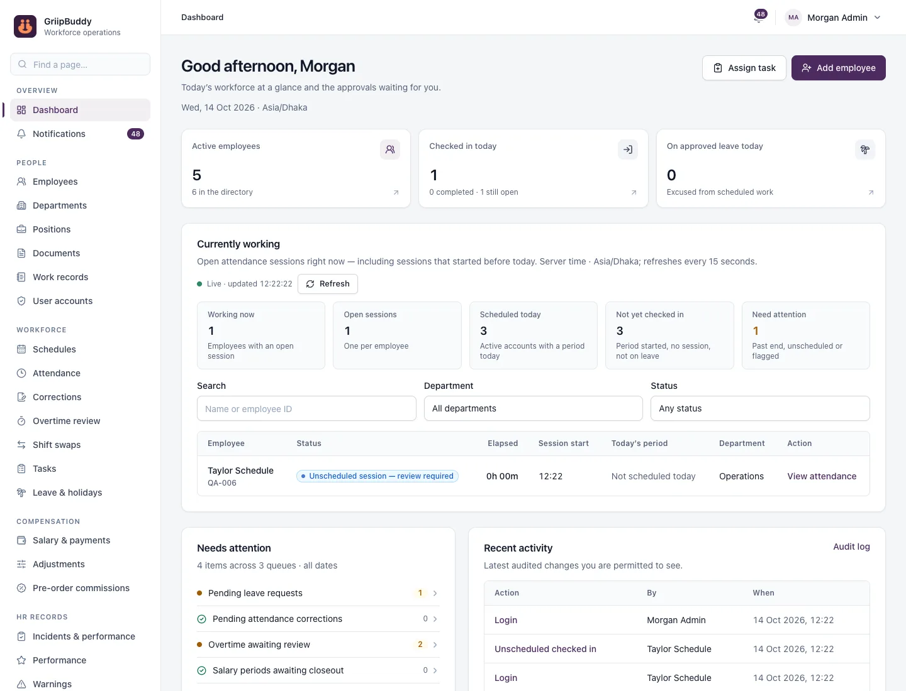
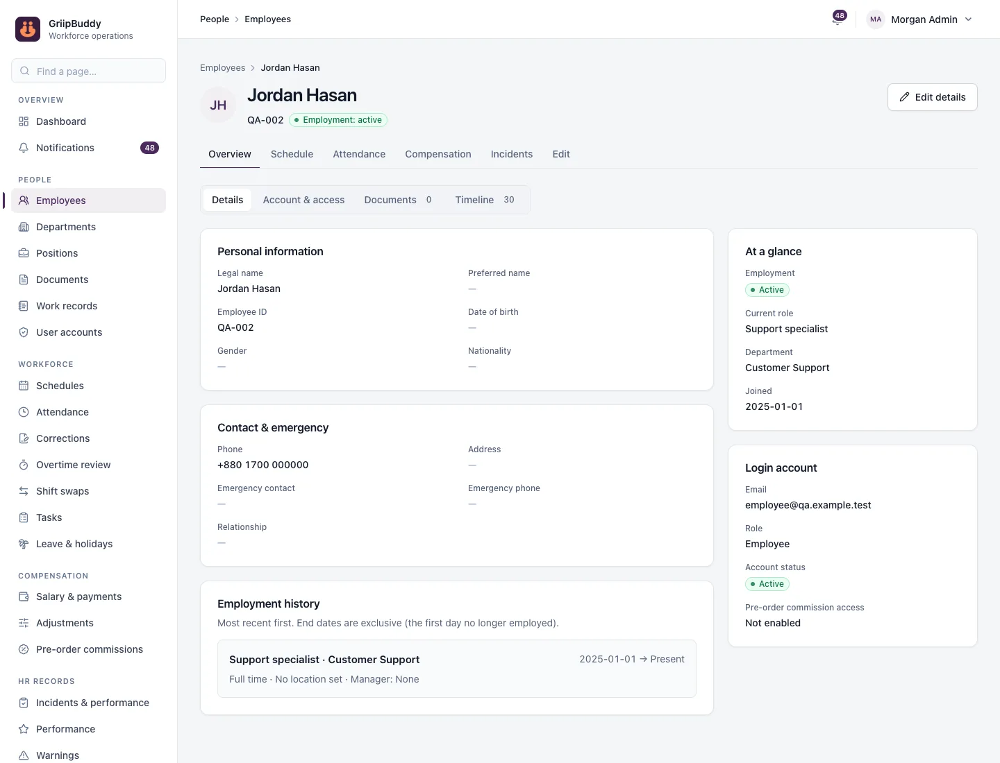
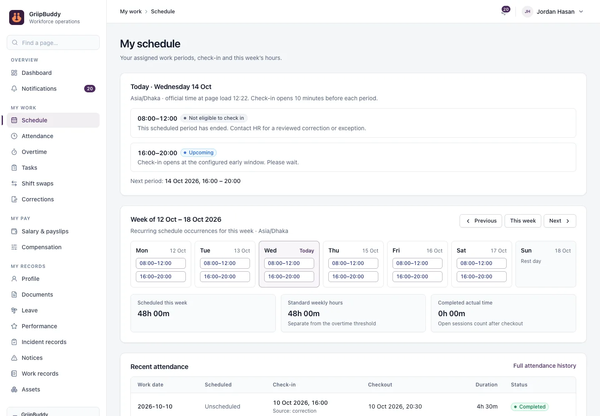

# GriipBuddy Employee Management

A self-hosted HR and workforce system for small and mid-sized organizations. It covers employee records, work schedules and live attendance, overtime approval, leave, monthly payroll with payslips, and HR records, in one secure web app with separate workspaces for administrators, HR managers and employees.




<table>
  <tr>
    <td></td>
    <td></td>
  </tr>
  <tr>
    <td align="center">Employee profile</td>
    <td align="center">Employee portal: schedule and check-in</td>
  </tr>
</table>

## Features

**People**
- Employee profiles with employment history, departments and positions
- Private documents with validated uploads (PDF, JPEG, PNG)
- A unified work timeline for each employee
- User accounts with Active, On hold and Suspended states, and admin password resets

**Schedules and attendance**
- Recurring weekly schedules, including multiple periods per day and overnight shifts
- Check-in and checkout from the employee portal, timed by the server clock in the organization's timezone, with a configurable early check-in window
- A **live "Currently working" view** on the dashboard and the Attendance page; it refreshes automatically and flags past-end, unscheduled and incomplete sessions
- Attendance corrections that employees request and staff approve, plus unscheduled work and shift swaps

**Overtime and leave**
- Weekly overtime calculated from completed work. Nothing is payable until a reviewer approves it.
- Configurable leave types with yearly allowances and balances, company holidays, and approval workflows

**Payroll**
- Monthly salary: calculate, review, approve, finalize, then record the payment
- Effective-dated compensation, bonuses, allowances and deductions, and optional pre-order commissions
- PDF payslips, a payment register, and a CSV export for bank or mobile payments
- Exact decimal arithmetic. Finalized salaries never change; corrections go into a later month.

**HR records**
- Performance reviews, warnings with employee acknowledgement, and incident and performance records with employee responses
- Asset assignments, tasks, and work records

**Insights and control**
- Role dashboards and in-app notifications
- Reports with CSV and PDF export: employees, attendance, overtime, late and absent, leave, salary, commissions, documents and tasks
- An append-only audit log of every change
- **Your organization's branding and rules:** name, legal name, address, logo, brand color, timezone, currency, attendance and leave rules, optional modules, and editable lists

**Three roles**
- **Administrator:** everything, including user accounts, settings and payroll finalization.
- **HR / Manager:** day-to-day people, attendance, leave and payroll preparation.
- **Employee:** their own schedule, attendance, leave, payslips and records only.

Every rule is enforced on the server.

## Quick start

Requirements: **Node.js 24** (see `.nvmrc`) and npm. Docker is optional for trying the app.

The fastest way to explore is the built-in demo workspace. It starts a private, throwaway PostgreSQL database on your machine and fills it with sample employees, schedules and records:

```sh
npm ci
npm run qa:local
```

Open http://127.0.0.1:3030. The sample accounts (administrator, HR, several employees) and their shared password are written to `.local/qa/accounts.json`. Add `-- --reset` to start again from fresh sample data. Nothing is sent anywhere, and the `.local/` folder is never committed.

## Running with Docker

1. Copy `.env.example` to `.env.compose.local`. Replace every `replace-…` value: generate `AUTH_SECRET`, `POSTGRES_PASSWORD` and `POSTGRES_APP_PASSWORD` separately with `openssl rand -hex 32`, then set the first administrator's email and a temporary password.
2. Build, prepare the database and start:

```sh
docker compose --env-file .env.compose.local build employee-app
docker compose --env-file .env.compose.local up -d employee-db
docker compose --env-file .env.compose.local -f docker-compose.yml -f docker-compose.tools.yml run --rm --no-deps employee-app npm run db:migrate
docker compose --env-file .env.compose.local -f docker-compose.yml -f docker-compose.tools.yml run --rm --no-deps employee-app npm run db:runtime-grants
docker compose --env-file .env.compose.local -f docker-compose.yml -f docker-compose.tools.yml run --rm --no-deps employee-app npm run db:bootstrap
docker compose --env-file .env.compose.local up -d employee-app
```

3. Open http://localhost:3000, sign in as the administrator and choose a new password. Remove the bootstrap values from the env file afterwards.

The setup has some built-in protections:
- The database has no public port.
- The app runs as a non-root user on a read-only filesystem.
- Database files and uploaded documents are kept in separate named volumes.

Two rules to follow:
- Never use `docker-compose.tools.yml` with `up`. It carries owner credentials for one-off commands only.
- Never run `down -v`, which deletes all data.

For live-reload development in Docker, add `-f docker-compose.dev.yml` to the `up` command.

### Without Docker

Provide a PostgreSQL 18 database with an owner account and a separate `employee_runtime` login. Put only the runtime variables in `.env`: `DATABASE_URL`, `APP_BASE_URL`, `AUTH_URL`, `AUTH_SECRET`, `ALLOW_LOCAL_HTTP`, `PRIVATE_DOCUMENTS_DIR` and `TZ`. Then run:

```sh
npm ci && npm run db:generate
MIGRATION_DATABASE_URL=… npm run db:migrate && MIGRATION_DATABASE_URL=… npm run db:runtime-grants
MIGRATION_DATABASE_URL=… BOOTSTRAP_ADMIN_EMAIL=… BOOTSTRAP_ADMIN_PASSWORD=… npm run db:bootstrap
npm run dev
```

## Make it yours

Everything organization-specific is set in the app, not in code. Sign in as an administrator and open **Settings**:

| Section | What you set |
|---|---|
| Branding | Display name, legal name and address (printed on PDFs), brand color and logo |
| Rules | Timezone, currency, early check-in window, late grace period, working days, leave counting and balance policy, salary payment day |
| Modules | Turn optional areas on or off: tasks, shift swaps, commissions, performance, warnings, incident records, assets, work records |
| Lists | Leave types (paid or unpaid, with a yearly allowance), salary adjustment types, document types, asset types, employment types |
| Overtime | Weekly overtime threshold, versioned from a future week |

Then create **Departments** and **Positions**, add **Employees** (each with a login), publish their **Schedules**, and enter **Compensation** on each profile.

The timezone and currency lock once official time or pay records exist, so set them first. Disabled modules disappear from navigation, and their pages and APIs return "not found".

## Configuration

| Variable | Purpose |
|---|---|
| `APP_BASE_URL` / `AUTH_URL` | The exact browser address, for example `https://hr.example.com`. HTTPS is required outside local development. |
| `AUTH_SECRET` | Session encryption key (at least 32 random characters). Changing it signs everyone out. |
| `ALLOW_LOCAL_HTTP` | `true` only for local HTTP use. |
| `DATABASE_URL` | Connection for the least-privileged `employee_runtime` database user. |
| `POSTGRES_DB`, `POSTGRES_USER`, `POSTGRES_PASSWORD`, `POSTGRES_APP_PASSWORD` | Database name, owner account and runtime password (Docker). |
| `MIGRATION_DATABASE_URL` | Owner connection for one-off migration commands only. |
| `BOOTSTRAP_ADMIN_EMAIL`, `BOOTSTRAP_ADMIN_NAME`, `BOOTSTRAP_ADMIN_PASSWORD` | Create the first administrator on an empty database. |
| `PRIVATE_DOCUMENTS_DIR` | Private folder for uploaded documents (outside Docker). |
| `REMEMBER_ME_DAYS` | "Remember me" session length, 1–90 days (default 30). Normal sessions last 12 hours. |
| `EMAIL_DELIVERY_URL`, `EMAIL_DELIVERY_TOKEN` | Optional HTTPS email adapter, used to verify login email changes. |

The normal app never receives owner or bootstrap credentials; production startup refuses them.

## Tests

```sh
npm run typecheck     # TypeScript
npm run lint          # ESLint
npm test              # unit tests
npm run test:integration   # service tests against real, throwaway PostgreSQL databases
npm run build && npm run test:http   # HTTP acceptance tests against the production build
npm run test:e2e      # browser tests (Playwright) against a running local workspace
```

The integration and HTTP tests start their own disposable PostgreSQL servers and never touch your database. The browser tests use Brave by default; set `BRAVE_PATH` to another Chromium-based browser if needed.

## Deployment

See **[docs/deployment.md](docs/deployment.md)**. It explains how to run the app on a Linux server behind Nginx, how to release a new version safely (verified encrypted backup, restore drill, guarded switch-over), how to roll back, and how to install on a new server.

## Documentation

- [User guide](docs/user-guide.md): day-to-day use for administrators, HR and employees
- [Architecture](docs/architecture.md): how the code, data and security model fit together
- [Deployment](docs/deployment.md): installation, releases, backups and rollback

## Project structure

```text
src/app/          Pages, layouts and API routes (Next.js App Router)
src/features/     Business logic per area: people, time, review, pay, insights, settings, …
src/components/   UI components (shadcn/ui-style, in src/components/ui)
src/lib/          Authentication, authorization, database, documents, PDFs, validation
prisma/           Database schema and SQL migrations
scripts/          Database setup, demo workspace, notification job, backup tools
tests/            Unit, integration and browser tests
docker/           Database initialization script
docs/             Guides and screenshots
```

## Security

- Every page, action and API checks the signed-in user's role and account status against the database. Employees can only reach their own records.
- Passwords are hashed with Argon2id. Temporary passwords expire after 24 hours and must be changed. Accounts lock after repeated failures.
- Official times come from the database clock, never from the browser. Attendance, finalized pay and audit history are protected by database triggers.
- Documents are stored privately, validated on upload and only served after an authorization check.
